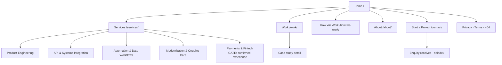
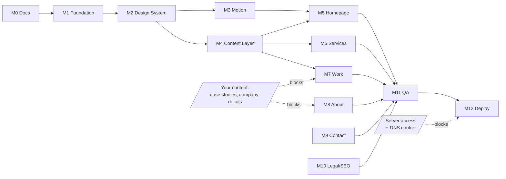

# Premium IT Solutions Website — Phase 1 Plan (Discovery, Creative Direction & Implementation)

**Status:** Planning only. No implementation until approved.
**Date:** 2026-10-11
**Repository:** `azariahjerish/solutionmines` · branch `claude/blissful-babbage-4uy884`

---

## Context — why this plan exists

The company has been delivering software through freelance engagements and now needs a public company website that establishes the brand, demonstrates engineering capability, builds trust with serious business buyers, and generates enquiries. A server and domain are said to exist. The internal admin portal is explicitly deferred.

The intended outcome of Phase 1 is a production-ready, art-directed marketing site — fast, accessible, and distinctive enough that a prospective client's first impression is "these people understand design and engineering."

**The decisive discovery:** the repository is completely empty. There is no existing site to extend, no stack to respect, no brand to inherit. Every architectural and creative decision is open, and every one of them is therefore mine to justify rather than inherit.

---

## Executive Summary

**The audit found nothing to audit.** `azariahjerish/solutionmines` has zero commits, zero files, and zero remote refs. There is no partial website, no framework, no dependencies, no assets, no deployment config, and no documentation. I verified this three independent ways. This is pure greenfield — which removes every migration constraint and also removes every piece of evidence I might have used to infer your intentions.

**I could not verify your server or domain, and I have not pretended otherwise.** DNS egress in this sandbox is restricted to a short allowlist — I confirmed with a control test that `example.com` and `nextjs.org` both fail to resolve while `github.com` succeeds. Any lookup I ran would therefore have been meaningless. Your confirmation of a Node-capable VPS with root access is what the architecture rests on; it still needs on-box verification before deployment.

**Recommended creative direction: "Specification"** — an editorial, typography-led system with art-directed dark interludes at the case-study heroes, the Work index, and the closing CTA. It wins the comparison matrix 4.85 to 3.30 and 2.95, and it wins for reasons that map to your business goals rather than to taste: it is the only one of the three that is genuinely differentiated in a category where dark-plus-glow is the default; it is accessible and fast by construction rather than by effort; and critically, **editorial layouts flatter a small body of work** — six case studies read as a considered portfolio in an editorial grid and as a sparse one in a card grid. For a new company that is a decisive practical advantage.

**Recommended stack: Next.js 16.4 + TypeScript + Tailwind v4 + GSAP + Lenis, self-hosted via Docker on your VPS behind nginx.** Next wins on a single asymmetry: for a pure marketing site Astro would be marginally faster, and I want to be honest about that — but your deferred admin portal is exactly the shape of application Astro is not built for, and choosing it would mean a second application at Phase 2. Three.js is explicitly excluded.

**Everything is achievable at zero recurring cost.** All four recommended typefaces are OFL-1.1 and self-hostable (verified on npm). Analytics is self-hosted Umami (MIT). Spam prevention needs no paid service. The signature visual element costs under 0.3ms per frame and adds no bundle weight.

**Four things I verified rather than assumed, each of which changed the plan:**

| Finding | Consequence |
|---|---|
| My first accent red measured **4.34:1 — failing AA for body text** | Corrected to `#B8371F` (5.53:1). It would have passed an eyeball check and failed a real audit. |
| **Fontshare licences restrict redistribution** | Ruled out Satoshi/Clash Display for self-hosting. Switched to OFL-only faces, which explicitly permit bundling. |
| `typescript@7.0.2` is latest, but `typescript-eslint` peers `<6.1.0` | Pin `typescript@~6.0.3`, or type-aware linting **breaks silently**. |
| `@studio-freight/lenis` is **formally deprecated** | Install `lenis`. npm returns an explicit rename notice. |

**The largest risk is not technical.** It is R1: case studies never materialising. M1–M6 need nothing from you; M7, M8 and M10 are blocked on content only you can supply. Starting content collection now, in parallel with the build, is the single best thing you can do to protect the timeline.

**I need three decisions before anything is built** (§10): the creative direction, the light-with-dark-interludes refinement, and the confirmed company name and legal entity.

### Where the deliverables live

Your brief asked for 14 deliverables saved to a documentation directory. **Plan mode permits me to write only this plan file**, so all 14 are consolidated here, mapped below. On approval, **M0 splits them into a structured `docs/` set** in the repository and commits it to `claude/blissful-babbage-4uy884` — before any application code is written.

| # | Deliverable | Section |
|---|---|---|
| 1 | Repository and environment audit | §1 |
| 2 | Missing information and assumptions register | §1.3, §2 |
| 3 | Three distinct creative directions | §3 |
| 4 | Design reference research with source links | §3.3 |
| 5 | Recommended visual direction and rationale | §3.2, §3.4 |
| 6 | Sitemap and page/section specifications | §5.1–§5.4 |
| 7 | Motion design system and animation inventory | §4.5–§4.10 |
| 8 | Brand, content and portfolio requirements | §5.5–§5.8 |
| 9 | Design tokens and reusable component plan | §4.1–§4.4, §4.11 |
| 10 | Recommended technical architecture | §6 |
| 11 | Server and deployment plan | §6.6–§6.7 |
| 12 | Performance, accessibility, SEO and testing strategy | §7 |
| 13 | Phased roadmap with acceptance criteria | §8 |
| 14 | Risks, dependencies and decisions needing approval | §9, §10 |

**Optional separate deliverable:** if you want to de-risk the direction choice before committing to a full build, I can produce a **standalone static visual prototype** — the homepage hero and one section, in the chosen direction, with real type and real motion, as a single HTML page that is not the production site. That is decision Q8.

---

## 1. Repository & Environment Audit

### 1.1 Findings — verified

I inspected the repository directly. Every item below is a verified fact, not an inference.

| Area | Finding | Evidence |
|---|---|---|
| Repository contents | **Completely empty.** One entry: `.git`. Zero source files. | `find . -not -path "./.git/*"` returns only `.` |
| Git history | **Zero commits.** Branch `claude/blissful-babbage-4uy884` is unborn. | `.git/objects` contains 0 object files; `git log` fails with "does not have any commits yet" |
| Remote | `https://github.com/azariahjerish/solutionmines` — public, size 0, **zero refs** | `git ls-remote origin` returns nothing |
| Default branch | GitHub declares `main`, but it **does not exist as a ref** | Remote metadata |
| Repo visibility | **Public**, secret scanning + push protection enabled | GitHub API |
| Package manifests | **Absent** — no `package.json`, lockfile, `composer.json`, `requirements.txt`, `go.mod` | Filesystem |
| Framework | **None.** No Next/Nuxt/Vite/Astro/Laravel/Django evidence | Filesystem |
| Dependencies | **None.** No GSAP, Tailwind, React, Three.js — nothing installed or declared | Filesystem |
| Config files | **Absent** — no tsconfig, tailwind, eslint, prettier, postcss, editorconfig | Filesystem |
| Build/test/lint commands | **None exist** | No manifest, no Makefile, no scripts |
| Source components | **None.** Zero files of any source extension | Filesystem |
| Design tokens | **None.** No CSS custom properties, no theme config, no SCSS variables | Filesystem |
| Assets | **None.** No `public/`, `static/`, or `assets/`. No logo, fonts, images, or icons | Filesystem |
| Deployment config | **Absent** — no Dockerfile, compose, GitHub Actions, vercel.json, netlify.toml, nginx conf, PM2, Procfile | Filesystem |
| Environment config | **No `.env` files of any kind exist.** No keys to list, nothing redacted | Filesystem |
| Documentation | **None.** No README, no `docs/`, no `.md` files, no `CLAUDE.md` | Filesystem |
| Tests | **None.** No test files, framework, or config | Filesystem |
| Partial site to preserve | **Nothing exists to preserve.** Fully greenfield, zero migration constraints | Filesystem |

### 1.2 Container toolchain — context only, not a deployment signal

Node v22.22.0 · npm 10.9.4 · pnpm 10.28.0 · yarn 1.22.22 · bun 1.4.2 · docker 29.8.2 · python 3.13.16 · php 8.3.6 · go 1.24.7 · ruby 3.3.6 · git 2.43.0

These are facts about *this sandbox*, not about your production server. They imply nothing about the deployment target.

### 1.3 What I could NOT verify — explicitly unknown

| Unknown | Why I could not verify it | Impact |
|---|---|---|
| **The server** — OS, specs, web server, Node availability, existing services | No credentials, no hostname, nothing in the repo | Resolved by your answer: Node VPS with root access. Still needs on-box confirmation before deploy. |
| **The domain** — registrar, DNS, current records, TLS status | DNS egress in this sandbox is proxy-restricted. I confirmed this with a control test: `example.com` and `nextjs.org` both **fail** to resolve here while `github.com` resolves. My lookups therefore prove nothing either way. | Must be confirmed before DNS/TLS work. I have **not** concluded anything about the domain. |
| Company legal name, address, registration, contact details | Not supplied | Blocks legal pages, schema markup, footer |
| Prior project details, client consent to be named | Not supplied | Blocks case studies |
| Team size, roles, photographs | Not supplied | Blocks About page |

### 1.4 Verified external facts underpinning this plan

Checked today rather than recalled, because these move:

| Fact | Status | Source |
|---|---|---|
| **GSAP is free for commercial use**, including ScrollTrigger, SplitText, Flip, MorphSVG | Confirmed. License effective 2025-04-30 | [Webflow announcement](https://webflow.com/blog/gsap-becomes-free) · [GSAP license](https://gsap.com/community/standard-license/) |
| Core Web Vitals thresholds unchanged for 2026: **LCP ≤2.5s, INP ≤200ms, CLS ≤0.1** at p75 | Confirmed | [corewebvitals.io](https://corewebvitals.io/core-web-vitals) |
| Current npm latest: `next` **16.4.0**, `nuxt` 4.6.1, `astro` 7.3.8, `gsap` **3.15.0**, `lenis` **1.3.26**, `tailwindcss` **4.3.3**, `motion` 14.1.0, `three` 0.186.1 | Verified via `npm show` | Live registry |
| Next.js 16 is the **LTS line**, supported to 2027-10-21; Next.js 15 support ends 2026-10-21 | Confirmed | [versionlog](https://versionlog.com/nextjs/) |
| Tailwind v4 uses **CSS-first `@theme` config**; no `tailwind.config.js` required | Confirmed | [Tailwind v4 docs](https://v3.tailwindcss.com/docs/v4-beta) |
| **Fontshare fonts (Satoshi, Clash Display) restrict redistribution** — self-hosting the files may require written permission | Confirmed by multiple secondary sources | [License discussion](https://madegooddesigns.com/fontshare/) |
| **All four recommended typefaces are OFL-1.1 and self-hostable**, published as npm packages at v5.3.0: `@fontsource/instrument-serif`, `@fontsource-variable/geist`, `@fontsource-variable/geist-mono`, `@fontsource-variable/bricolage-grotesque` | Verified via `npm show <pkg> license` | Live registry |
| Cloudflare **Turnstile Free = $0**, unlimited challenges, 20 widgets | Confirmed | [Cloudflare plans](https://developers.cloudflare.com/turnstile/plans/) |
| **Umami is MIT-licensed**; Plausible CE is AGPL-3.0 | Confirmed | [Comparison](https://wz-it.com/en/blog/plausible-umami-matomo-comparison/) |

> The Fontshare finding materially changed my typography recommendation. Because you want zero recurring cost **and** self-hosted fonts for performance, I am recommending **OFL-licensed** faces only — OFL explicitly permits bundling and redistribution, Fontshare's license does not.

---

## 2. Assumptions & Decisions Register

### 2.1 Confirmed by you

| # | Decision | Consequence |
|---|---|---|
| D1 | **Node.js VPS with root access** | Next.js with SSR/ISR, nginx reverse proxy, systemd, certbot. Admin portal can later live on the same box. |
| D2 | **Real client work exists and clients can be named** | A genuine Work section ships at launch with real case studies. Biggest credibility asset you have. |
| D3 | **No brand assets — design from scratch** | Each creative direction includes a full identity proposal: logotype concept, palette, typography. |
| D4 | **Zero recurring cost** | OFL fonts only, self-hosted Umami analytics, self-hosted SMTP or free-tier email, Turnstile free tier. |

### 2.2 Assumptions I am making (flag any that are wrong)

| # | Assumption | Risk if wrong |
|---|---|---|
| A1 | Server is Ubuntu/Debian with nginx available or installable | Low — plan adapts to any Linux + reverse proxy |
| A2 | Server has ≥2 GB RAM for Node + Umami + Postgres | Medium — if smaller, drop Umami to log-based analytics |
| A3 | You control DNS for the domain | Medium — blocks TLS and launch |
| A4 | English-only at launch, no i18n | Low — i18n is costly to retrofit; say now if multi-language is needed |
| A5 | Company name is "SolutionMines" or similar | Low, but confirm — it appears in logo, metadata, and schema |
| A6 | 3–6 case studies available at launch | **High** — fewer than 3 weakens the Work section materially |
| A7 | No immediate blog publishing capacity | Medium — an empty blog is worse than no blog |

### 2.3 Non-negotiable constraints carried from your brief

- No invented testimonials, client logos, metrics, team counts, or years of experience.
- No generic AI-looking layouts or repetitive gradient cards.
- No animation added merely to look busy.
- No admin portal, CRM, billing, or auth in this phase.
- No DNS changes, production releases, or live infrastructure modification without explicit approval.

---

## 3. Three Creative Directions

All three assume the same content and the same performance budget. They differ in art direction, type, palette, signature element, and motion language. Each includes an identity proposal, since no brand exists.

### Direction A — "SIGNAL"
*Cinematic, dark, immersive digital engineering brand*

| Aspect | Specification |
|---|---|
| **Concept** | Software as signal through noise. The company turns ambiguous business problems into clean, legible systems. Near-black canvas, volumetric depth, light used as the primary material. |
| **Personality** | Confident, technical, atmospheric, slightly cinematic. |
| **Palette** | Base `#07080A` → raised `#101317`. Text `#F2F4F7` / muted `#8A929E`. Single accent: electric cyan-white `#7FE7E0` used **sparingly** as emitted light, never as fill. |
| **Typography** | Display: **Bricolage Grotesque Variable** (OFL, multi-axis: weight/optical-size/width/grade) set tight and large. Body: **Geist** (OFL). Mono: **Geist Mono** for technical annotation. |
| **Layout** | Full-bleed cinematic frames. Deep vertical rhythm. Content floats in space rather than sitting in boxes. |
| **Signature element** | **The Signal Line** — one continuous luminous SVG stroke that threads the entire page, bending through every section, branching at the services, converging at the CTA. Drawn on scroll via `stroke-dashoffset`. It is literally the thread from problem to delivered system. |
| **Motion language** | Slow, weighted, cinematic. Long eases. Light blooms. Parallax depth layers. |
| **Advantages** | Reads "technical" instantly. Photography-light, so it works without a big asset budget. Accent-on-dark is striking. |
| **Disadvantages** | **This is the most crowded aesthetic in the category.** Dark + glow + gradient is precisely the generic look your brief forbids, and it takes real discipline to avoid. Dark-mode accessibility is harder: large dark surfaces plus thin light type reduce readability. |
| **Performance** | Good, if the signal line stays SVG. Becomes poor the moment it tempts WebGL. |
| **Audience fit** | Strong with CTOs and technical buyers. Weaker with non-technical commercial buyers. |

### Direction B — "SPECIFICATION"
*Editorial, typography-led technology studio*

| Aspect | Specification |
|---|---|
| **Concept** | The site is set like a beautifully typeset technical specification. Engineering rigour expressed as typographic rigour. Numbered sections, hairline rules, margin annotations, tabular figures, precise measurements. |
| **Personality** | Precise, literate, confident, unfashionable in the best sense — built to age well. |
| **Palette** | Warm paper `#FAF9F6` → raised `#FFFFFF`. Ink `#111316`, muted `#5B6169`, decorative hairline `#DEDAD2`, functional border `#8F8676`. Accent: deep signal red **`#B8371F`** reserved for marks, numerals, and the active state only. Plus **art-directed dark interludes** (see recommendation). All values contrast-verified — see §3.4. |
| **Typography** | Display: **Instrument Serif** (OFL) for editorial headlines — a serif in a sea of grotesques is itself the differentiator. Body/UI: **Geist** (OFL). Mono: **Geist Mono** for section numbering, specs, and metadata. |
| **Layout** | A visible 12-column editorial grid with a genuine margin column used for annotations. Asymmetry, generous whitespace, strong baseline rhythm. |
| **Signature element** | **The Spec Rule** — every section carries a hairline rule, a monospace section number (`01 / CAPABILITY`), and a margin annotation. The grid is not hidden; it is the ornament. |
| **Motion language** | Restrained and typographic. Line-by-line masked text reveals. Rules that draw themselves. Nothing bounces, nothing glows. |
| **Advantages** | **Genuinely differentiating** — almost no dev agency looks like this. Extremely cheap to render; no WebGL, no heavy assets. High contrast by construction, so accessibility is nearly free. Editorial layouts make a small body of work feel substantial, which matters directly given a new company's thin portfolio. Works beautifully with free OFL fonts. |
| **Disadvantages** | Demands genuine typographic discipline — it fails badly if executed sloppily. Light-dominant may read "less technical" to some buyers. Needs real copy; it cannot hide behind visuals. |
| **Performance** | **Best of the three.** Type and vector only. LCP is a text node. |
| **Audience fit** | Strong across both technical and commercial buyers. Reads as "serious firm." |

### Direction C — "INDEX"
*Refined, minimal, premium enterprise technology brand*

| Aspect | Specification |
|---|---|
| **Concept** | The entire site is a living index. Navigation is work-led: large kinetic type lists that expand into previews on hover. Content over chrome. |
| **Personality** | Composed, premium, quietly expensive, restrained. |
| **Palette** | Monochrome graphite ramp `#0E0E0E` → `#F5F5F4`, a single electric accent `#2B5BFF`. Near-zero colour elsewhere. |
| **Typography** | Display + body: **Geist Variable** (OFL) across the whole scale, differentiated by weight and size alone. Mono: **Geist Mono**. Deliberately single-family. |
| **Layout** | Large type lists as primary navigation. Tight, confident, minimal. Heavy whitespace. |
| **Signature element** | **The Expanding Index Row** — each project/service is a full-width row of large type; on hover the row expands in place to reveal a preview, metadata, and entry point. Browsing is the interaction. |
| **Motion language** | Crisp, fast, precise. Short eases. Expansion and collapse. No ambient movement at all. |
| **Advantages** | Very usable; browsing work is the core interaction, which serves the business goal directly. Minimal asset requirements. Ages well. Trivially accessible. |
| **Disadvantages** | **Least memorable of the three.** Minimalism without a strong signature risks reading as unfinished or as a template. Depends heavily on the quality of project imagery, which is currently unknown. |
| **Performance** | Excellent. |
| **Audience fit** | Strong with enterprise buyers; may underwhelm clients who explicitly want to be wowed. |

### 3.1 Comparison matrix

| Criterion (weight) | A — Signal | B — Specification | C — Index |
|---|:--:|:--:|:--:|
| Distinctiveness in category (25%) | 2 | **5** | 3 |
| Credibility with business buyers (20%) | 3 | **5** | 4 |
| Performance headroom (15%) | 3 | **5** | 5 |
| Accessibility by construction (10%) | 2 | **5** | 4 |
| Works with thin portfolio (10%) | 3 | **5** | 2 |
| Asset budget required (10%) | 4 | **5** | 2 |
| Memorability / "wow" (10%) | **5** | 4 | 2 |
| **Weighted total** | **2.95** | **4.85** | **3.30** |

Scores are 1–5, higher is better. Weights reflect your stated goals: establish brand, build trust, generate enquiries, stay fast and accessible.

### 3.2 Recommendation — **Direction B, "Specification," with art-directed dark interludes**

Direction B wins on every criterion that maps to your business goals, and it wins decisively.

The reasoning that matters most:

1. **It is the only one of the three that is actually differentiated.** Dark-cinematic (A) is the default aesthetic of every software agency; executing it well means out-polishing hundreds of competitors on their own terrain. An editorial, typographically rigorous site stands out immediately in that field — and "we are more precise than the others" is exactly your brand claim.
2. **It performs and is accessible by construction, not by effort.** Its LCP element is a text node. Contrast is high because the palette is ink on paper. You get Core Web Vitals and WCAG AA nearly for free, which protects the brief's hard requirement that an impressive site must not be slow or inaccessible.
3. **It flatters a small body of work.** Editorial layouts — generous margins, annotation, numbering, scale contrast — make six case studies feel like a considered portfolio. Grid-of-cards layouts (A and C) make the same six look sparse. For a new company this is a decisive practical advantage.
4. **It fits the zero-cost constraint without compromise.** Instrument Serif and Geist are OFL, self-hostable, and genuinely premium.

**The one refinement I am proposing:** do not ship a uniformly light site. Use light as the dominant system and deliberately invert to a near-black treatment at specific art-directed moments — the case study heroes, the Work index, and the closing CTA. This gives you the cinematic impact of Direction A exactly where impact earns its keep, while keeping the reading experience light, fast, and legible. It is art direction rather than a theme toggle: the same token system, inverted semantically.

This is a recommendation, not a decision. **I need your sign-off before any of it is built.**

### 3.3 Design reference research

Real references, what to learn, and what *not* to copy.

| Reference | Link | What makes it effective | Do **not** copy |
|---|---|---|---|
| Awwwards — Sites of the Year | [awwwards.com/websites/sites_of_the_year](https://www.awwwards.com/websites/sites_of_the_year/) | 2025 winners (Lando Norris by OFF+BRAND; Messenger by abeto) show current ceiling for narrative scroll and WebGL craft | Their WebGL budget. Both carry asset weight inappropriate for a lean marketing site. |
| Awwwards — Typography honours | [awwwards.com/websites/winner_category_typography](https://www.awwwards.com/websites/winner_category_typography/) | 2025 typography winners demonstrate scale contrast and masked line reveals — directly relevant to Direction B | Decorative type that sacrifices legibility. |
| Awwwards — GSAP winners | [awwwards.com/websites/gsap](https://www.awwwards.com/sites/gsap) | Recent Developer Award + SOTD entries (LPAS/Studio Naam, Odyssée/NIGHTJAR, EDOLUS — all Oct 2026) show current scroll-timeline craft | Scroll-hijacking that breaks browser scroll semantics. |
| Typewolf — design studio sites | [typewolf.com/design-studios](https://www.typewolf.com/design-studios) | Curated studio sites; strong source for type pairing and editorial restraint. *Note: its date metadata is stale, so treat as directional.* | Studio-specific quirks that signal "agency" over "engineering firm." |
| DesignRush — tech website designs 2026 | [designrush.com/best-designs/websites/trends/best-tech-websites](https://www.designrush.com/best-designs/websites/trends/best-tech-websites) | Useful as evidence of the *default*: it explicitly notes dark backgrounds with light type is the category reflex. Confirms why Direction B differentiates. | The category reflex itself. |

### 3.4 Contrast verification — recommended direction

I computed these rather than estimating them (WCAG 2.1 relative luminance). This is the evidence behind the claim that Direction B is accessible by construction.

| Pair | Ratio | AA body (4.5:1) | AA large (3:1) |
|---|---:|:--:|:--:|
| Ink `#111316` on paper `#FAF9F6` | 17.67:1 | PASS | PASS |
| Ink `#111316` on white `#FFFFFF` | 18.61:1 | PASS | PASS |
| Muted `#5B6169` on paper | 5.94:1 | PASS | PASS |
| Accent `#B8371F` on paper | 5.53:1 | PASS | PASS |
| Accent `#B8371F` on white | 5.83:1 | PASS | PASS |
| Functional border `#8F8676` on paper | 3.42:1 | n/a | PASS (meets 1.4.11 non-text 3:1) |
| *Decorative hairline `#DEDAD2` on paper* | *1.32:1* | *n/a — decorative only* | *n/a* |
| **Dark interlude:** light `#F2F4F7` on `#07080A` | 18.18:1 | PASS | PASS |
| Muted `#8A929E` on `#07080A` | 6.38:1 | PASS | PASS |
| Muted `#8A929E` on raised `#101317` | 5.93:1 | PASS | PASS |
| Accent on dark `#E8573C` on `#07080A` | 5.59:1 | PASS | PASS |

**Two corrections this exercise forced**, which is exactly why it was worth doing:

- My initial accent red `#D1452B` measured **4.34:1 — it fails AA for body text.** Darkened to `#B8371F` (5.53:1). The original would have passed a casual eyeball check and failed a real audit.
- The hairline `#DEDAD2` is fine as decoration but is **not** usable for input borders or any boundary that conveys information. Those need the separate `#8F8676` token at 3.42:1 to satisfy WCAG 1.4.11. Two distinct tokens, not one.

The accent must also flip to a lighter tint (`#E8573C`) inside dark interludes — the light-mode red fails on near-black at 4.39:1. This is a semantic token, not a fixed colour.

> Honest caveat: visual-reference research is hard to do rigorously through search alone, and several roundups above are secondary sources of mixed reliability. I have distinguished what is verified (award status, dates) from what is directional (editorial opinion). If you want, I can assemble a proper visual moodboard as a separate reviewable deliverable before you commit to a direction.

---

## 4. Design System & Motion Specification

> **Scope note.** Everything in §4.1–§4.3 and §4.5–§4.8 is **direction-agnostic** — the token architecture, type scale, spacing, component inventory, motion tokens, animation inventory, reduced-motion policy and performance rules apply whichever creative direction you pick. Only the **colour assignments** (§4.4) depend on the choice, and those are specified for both the dark route and the recommended light-with-dark-interludes route.

### 4.1 Token architecture — three layers

| Layer | Lives in | Example | Rule |
|---|---|---|---|
| 1 · **Primitive** | `@theme` (private) | `--color-ink-950` | **Never referenced by a component** |
| 2 · **Semantic** | `@theme` | `--color-surface`, `--color-text-primary` | The only layer components touch |
| 3 · **Component** | component-local vars | `--btn-bg` | Resolves from layer 2; enables variants |

Enforce layer 2 with a lint rule — zero hard-coded hex and zero `ink-*` in component code. This single discipline is what makes a later theme addition a week rather than a month. Tailwind v4's `@theme` emits real CSS custom properties and generates utilities from them, so `--color-surface-raised` automatically yields `bg-surface-raised`. Use `@theme static` so every variable is emitted even if unused at build time — GSAP reads some at runtime.

### 4.2 Typography

**Recommended pairing (all OFL-1.1, self-hostable, verified on npm at v5.3.0):**

| Role | Face | Axes | Why |
|---|---|---|---|
| **Display** | **Instrument Serif** (Direction B) or **Bricolage Grotesque Variable** (Direction A/C) | Bricolage: `wght`, `wdth`, `opsz` | A serif in a sea of grotesques is itself the differentiator for the editorial direction |
| **Workhorse** | **Geist Variable** | `wght` 100–900 | Cooler and less ubiquitous than Inter; excellent at UI sizes |
| **Mono** | **Geist Mono Variable** | `wght` | Section numbering, specs, metadata. **The mono is what signals "engineering" without a single gear icon.** Metrics align with Geist Sans. |

**Dual-ratio fluid scale** — ~1.15 between steps at 360px (tight, so mobile hierarchy stays compact) opening to ~1.33 at 1440px (perfect fourth, so desktop becomes cinematic). The scale literally opens up as the viewport does.

| Token | Role | 360→1440 | `clamp()` | LH | Tracking |
|---|---|---|---|---|---|
| `display-2xl` | Hero | 40→120px | `clamp(2.5rem, 0.8333rem + 7.4074vw, 7.5rem)` | 0.92 | −0.03em |
| `display-xl` | Section opener | 34→88px | `clamp(2.125rem, 1rem + 5vw, 5.5rem)` | 0.96 | −0.025em |
| `display-lg` | Page H1 | 30→64px | `clamp(1.875rem, 1.1667rem + 3.1481vw, 4rem)` | 1.02 | −0.02em |
| `display-md` | H2 | 27→48px | `clamp(1.6875rem, 1.25rem + 1.9444vw, 3rem)` | 1.08 | −0.018em |
| `title-lg` | H3 | 22→32px | `clamp(1.375rem, 1.1667rem + 0.9259vw, 2rem)` | 1.18 | −0.012em |
| `body` | Body | 16→18px | `clamp(1rem, 0.9583rem + 0.1852vw, 1.125rem)` | 1.62 | 0 |
| `body-sm` | Captions | 14→15px | `clamp(0.875rem, 0.8542rem + 0.0926vw, 0.9375rem)` | 1.55 | +0.002em |
| `mono-label` | Eyebrows, section numbers | 12→13px | `clamp(0.75rem, 0.7292rem + 0.0926vw, 0.8125rem)` | 1.3 | **+0.1em** |

Negative tracking on display sizes is a correction, not decoration — grotesques and serifs are spaced for text sizes and look loose above ~36px.

**Measure:** long-form body caps at `--container-prose: 40rem`, which at 18px yields ~71 characters per line — inside the 45–75ch target.

> **Font loading is the single biggest CLS lever on a type-led site.** Use `next/font/local` with variable WOFF2, `display: 'swap'`, and `adjustFontFallback` left **on** — Next generates a metric-adjusted fallback (`size-adjust`, `ascent-override`) so the swap produces ~0 shift. This one setting is typically the difference between CLS 0.15 and CLS 0.00. Subset to `latin` + `latin-ext`; preload display and workhorse only, never the mono.

### 4.3 Spacing, breakpoints and grid

Keep Tailwind v4's dynamic spacing (`--spacing: 0.25rem`) so every `p-*`/`gap-*` is generated on demand, then layer named rhythm tokens for cross-section consistency: `--space-section: clamp(5rem, 3.3333rem + 7.4074vw, 10rem)` (80→160px), `--space-section-lg: clamp(7.5rem, 5rem + 11.1111vw, 15rem)` (120→240px), `--gutter: clamp(1.25rem, 0.3333rem + 4.0741vw, 4rem)`.

> Section rhythm uses `padding-block`, **never margin** — scroll-triggered reveals need predictable section boxes, and margin collapsing makes `ScrollTrigger.refresh()` results unstable.

**Breakpoints named by what changes, not by a phone model:**

| Token | Value | Content reason |
|---|---|---|
| `sm` | 480px | A 2-up grid of tags stops looking cramped |
| `md` | **768px** | **The two-column threshold.** 768 − 2×32 gutters = 704px; two 336px cards each hold ~45ch at 15px — the minimum readable card measure. Below this, two columns produce unreadable ragged copy |
| `lg` | **1024px** | **The editorial-split threshold.** 1024 − 2×48 = 928px; a 25/75 split leaves 696px, holding ~71ch at 18px. The 12-column grid and sticky-label pattern switch on here |
| `xl` | 1280px | Container reaches its 1200px cap; extra width goes to margins, not columns |
| `2xl` | 1600px | **Content stops growing entirely** — only the gutter grows. Prevents 2560px monitors stretching hero type to absurdity |

There is deliberately **no `xs`** — mobile-first base styles *are* the smallest breakpoint, and the floor is 360px, not 320px.

**A baseline grid is explicitly not recommended.** Fluid type plus `clamp()` line-heights makes true baseline alignment impossible to maintain, and faking it costs more than it returns. Use `--space-*` vertical rhythm instead.

**Elevation on dark surfaces** is communicated by surface lightness + border + a 1px inner top highlight — drop shadows are nearly invisible on near-black. Real shadows are reserved for elements floating above a scrim. **Never transition `box-shadow`** (it is a paint property); implement hover elevation as an absolutely-positioned `::after` carrying the target shadow and transition only its `opacity`, which is compositor-only and free.

**Grain:** one static tiled 128×128 WebP at `opacity: 0.035`, `mix-blend-mode: overlay`, `position: fixed`. **Reject** animated grain outright (forces continuous full-viewport repaint, destroys battery life, inflates INP) and reject full-bleed SVG `feTurbulence` (filter re-evaluated on resize, measurable paint cost on low-end Android). Budget exactly one blend-mode layer site-wide.

**`backdrop-filter` is restricted to one element: the sticky nav.** Gate behind `@supports` with an opaque fallback; never apply to an element simultaneously being transformed (blur + transform forces re-rasterisation every frame); never over more than ~15% of the viewport. On Safari this is the single most common cause of scroll jank in this genre — test on a real iPhone, not the simulator.

### 4.4 Colour — direction-dependent

**If you choose Direction B (recommended):** use the contrast-verified palette in §3.4. Key reminder: two distinct border tokens are required — `--color-border-subtle` `#DEDAD2` for decoration and `--color-border-interactive` `#8F8676` (3.42:1) for form controls, because WCAG 1.4.11 requires 3:1 on any boundary that conveys information.

**If you choose Direction A (dark-primary),** a fully contrast-audited dark system exists. Essentials:

| Semantic | Hex | Contrast on surface |
|---|---|---|
| `--color-surface` | `#080B0F` | — |
| `--color-surface-raised` | `#101418` | — |
| `--color-text-primary` | `#F4F6F8` | **18.20:1** |
| `--color-text-muted` | `#979CA2` | **7.13:1** |
| `--color-text-subtle` | `#797E84` | **4.82:1** — the floor |
| `--color-border-interactive` | `#797E84` | **4.82:1** (passes 1.4.11) |
| `--color-accent` | `#26B0F7` | 8.11:1 as text; takes **dark** label `#080B0F` at 8.11:1 when used as a fill |
| `--color-focus-ring` | `#9BD6FE` | **12.62:1** |

> **The characteristic failure of dark cinematic sites** is hairline `#1F2329` borders on form fields: beautiful, and an accessibility failure at ~1.2:1. The spec deliberately splits `border-subtle` (looks) from `border-interactive` (compliance) so the distinction is enforced by naming rather than by memory. Note also that `text-subtle` at 4.82:1 drops to 3.81:1 on `surface-active` — inside dialogs, secondary copy must step up to `text-muted`.

**Ship one theme in Phase 1, either way.** A second theme is not a token swap — it is a second art direction (different image masks, different grain opacity, a different elevation model since shadows only work on light), and it doubles a ~48-pair contrast audit. Architect for it now (semantic layer only, `color-scheme` declared, `:root[data-theme]` override shape reserved) and it becomes a week's work later.

### 4.5 Motion tokens

| Duration | Value | Use |
|---|---|---|
| `--dur-fast` | 150ms | Hover colour, focus ring, icon nudge |
| `--dur-base` | 240ms | Default UI transition |
| `--dur-slow` | 400ms | Dialog in, nav panel, card elevation |
| `--dur-slower` | 650ms | Scroll-triggered block reveal |
| `--dur-cinematic` | 900ms | Hero line reveal. **Maximum for anything a user waits on** |
| `--dur-exit` | **180ms** | **All exits.** Exits are always faster than entrances — nobody wants to watch something leave |

| Easing | cubic-bezier | When |
|---|---|---|
| `--ease-standard` | `(0.2, 0, 0, 1)` | **Default.** Anything entering or changing state in place |
| `--ease-out-quart` | `(0.25, 1, 0.5, 1)` | Scroll reveals, card entrances |
| `--ease-out-expo` | `(0.16, 1, 0.3, 1)` | The cinematic one — hero lines, image masks. **Sparingly**; on small elements it reads as sluggish |
| `--ease-in-out-quart` | `(0.76, 0, 0.24, 1)` | Elements that start and stop *within* view |
| `--ease-in-quart` | `(0.5, 0, 0.75, 0)` | **Exits only.** Never entrances |
| `--ease-spring` | `(0.34, 1.26, 0.64, 1)` | One overshoot for confirmations. Capped at 1.26 — above that it reads as a consumer app, not an engineering firm |

**Deliberately absent: any `elastic` or `bounce`.** Wrong for this brand.

**Stagger:** `--stagger-base: 0.08s` (lines), `--stagger-loose: 0.12s` (cards). **Governing rule: total stagger span must not exceed 600ms.** If `count × interval > 0.6`, switch to GSAP's `stagger: { amount: 0.6 }` so the span is fixed and the interval compresses. A 12-card grid at 0.12s takes 1.44s — the last card arrives after the user has scrolled past it.

**Distance:** `--move-md: 16px` (default reveal), `--move-lg: 24px` (**hard cap for any LCP-candidate element**), `--move-mask: 110%` (110 not 100, so descenders clear fully).

### 4.6 Animation inventory (condensed)

Full inventory is 30 entries; these are the load-bearing ones. Every entry has a stated purpose — **if a row's purpose is "it looks nice", it is cut.**

| ID | What | Purpose | Technique | Reduced-motion | Key risk + mitigation |
|---|---|---|---|---|---|
| A01 | **Entry veil**, 450ms, once per session | Covers the font-swap and hydration moment | Fixed CSS layer, removed on `animationend` | 120ms opacity fade | **Blocks LCP if done wrong.** Hero renders *behind* the veil so LCP paints during it. Hard kill timer at 800ms regardless of state |
| A02 | **Hero line reveal** | The single most art-directed moment | GSAP + SplitText lines in `overflow:hidden` wrappers | Block fade, 200ms, no split | **LCP conflict — critical.** Chrome does not count `opacity:0` elements as LCP candidates. **Line 1 animates at `opacity:1` with transform only and zero delay**; only lines 2+ use the masked reveal |
| A04 | **The Trace** (signature) | Scroll progress + section index + wayfinding | SVG `stroke-dashoffset`, `scrub: 0.6` | Static full-length line, nodes filled | Repaint region is ~24×viewport px — negligible. No filters on the path |
| A06 | **Section reveal** | Rhythm; signals "new idea" | **IntersectionObserver + CSS class, not GSAP.** One observer, many targets | Final state applied immediately | Initial `opacity:0` must ship in **server-rendered CSS** (`html.js .reveal`), not applied by JS after hydration |
| A07 | **Line-level text reveal** | Makes reading feel directed | GSAP + SplitText + `ScrollTrigger.batch` | Single block fade; SplitText never instantiated | **Must run after `document.fonts.ready`** with `autoSplit: true`. Splitting against fallback metrics then re-flowing is the #1 source of animation CLS |
| A09 | **Process scrub (horizontal pin)** | **The one justified pin** — the process is genuinely sequential and horizontal travel carries meaning | ScrollTrigger `pin + scrub: 1` | Vertical `<ol>`, no pin | Pin-spacer causes CLS if it initialises before layout settles. `refresh()` after fonts + images; `anticipatePin: 1`. **Scroll distance capped at 2.5× viewport** — longer and users think the page is broken |
| A11 | **Image mask reveal** | Hides the image-decode moment | Sibling mask panel translates `0 → -101%`; **`clip-path` avoided** | Final state | `clip-path` animation is **not** reliably compositor-accelerated — it repaints. Translating a panel is pure transform |
| A16 | **Magnetic button** (max 2/page) | Makes the most important target feel alive | `gsap.quickTo` on x/y | Disabled | **INP risk.** Read `getBoundingClientRect()` once on `pointerenter` and cache it — never read layout inside `pointermove`. Keyboard focus gets the identical *end state* via `:focus-visible`, so nothing is hover-only |
| A18 | **Work card hover preview** | Highest-value interaction for a prospect — assess relevance without a click | CSS + optional muted video after 150ms intent delay | Overlay change only | `preload="none"`, ≤3s, ≤400KB, one playing at a time, **skipped entirely on `saveData` or sub-4g**. `focus-within` must match hover |
| A25 | **Stat count-up** | Makes proof land as achievement | GSAP tween on a proxy, `textContent` in `onUpdate` | Final value rendered immediately | **CLS from digit-width change** — `12` → `1,284` changes width. `tabular-nums` + reserve the final width. Animating node is `aria-hidden` with the final value in an `sr-only` sibling; never let AT announce a spinning number |
| A26 | **Marquee** | More proof in less vertical space | CSS keyframe on a duplicated track | **Paused**, container becomes scrollable | **WCAG 2.2.2: moving content over 5s legally needs a pause mechanism.** Pause on hover *and* `focus-within`; IO-pause when off-screen |

**Where pinning is explicitly NOT justified** — all ruled out: pinning the hero while content scrolls over it (costs 1–2 viewport-heights of scroll for zero information); pinning the services list (it is a list, not a sequence); any "scroll to continue" interception; pinned image sequences (bandwidth disaster).

**Two judgement calls the brief asked for:**

> **Should a preloader exist?** Mostly no — and what is specified is not one. A loading screen that counts to 100 taxes every visitor for one dramatic moment and directly degrades LCP, the metric your ranking depends on. But a hard cut into a page whose fonts are still swapping looks cheap. So: a **450ms entry veil, once per session, that never blocks rendering**, with a hard 800ms kill timer. It is a transition, not a wait. Anything over ~600ms should be rejected in design review.

> **Does a custom cursor earn its place?** Only in one form. A cursor that *replaces* the system cursor is an accessibility regression — it overrides OS cursor size and contrast settings, breaks pointer precision, and conveys nothing. A cursor that *augments* — a small ring picking up a contextual label ("View case") while the native cursor stays visible — adds real affordance information where clickable regions are ambiguous. **If the design requires `cursor: none`, cut it entirely.**

### 4.7 Reduced-motion policy — a rule set, not a promise

| Category | Policy | Examples |
|---|---|---|
| **Removed entirely** | Renders in final state | Parallax, pinned horizontal scrub, magnetic buttons, custom cursor, ambient loops, count-ups, hover video, **and Lenis smooth scroll** |
| **Substituted** | ≤200ms opacity-only | Hero reveal, section reveals, SplitText reveals (**never instantiated**), image masks, page transitions |
| **Paused but present** | Content stays, motion stops | Marquee (paused at frame 1, container scrollable), the Trace (drawn full-length, static) |
| **Kept unchanged** | Short, non-vestibular, informational | Focus rings, link underlines, colour transitions, button loading, dialog opacity |

**Guiding principle:** `prefers-reduced-motion` means *vestibular safety*, not *no feedback*. Stripping every transition makes an interface feel broken. What goes is **travel, scale, parallax, scrub and loops**. What stays is **opacity, colour and instant state change**.

Two entries that are routinely missed: **Lenis must be destroyed** (smooth-scroll decouples scroll from input and is a textbook vestibular trigger), and **SplitText must not run at all** — not "run then skip the animation"; the DOM mutation is pointless work and a risk to assistive tech.

**Implemented once, globally**, in a single `MotionProvider` — four coordinated pieces:

1. **A user-facing toggle**, because the OS setting is not universally discoverable. Persisted and applied via a **blocking inline script in `<head>`** so there is no flash of motion.
2. **A CSS kill-switch** as the safety net, using `1ms` **not** `0s` — so `animationend`/`transitionend` handlers still fire and nothing that depends on them hangs. *This is the single most common bug in reduced-motion implementations.*
3. **One `gsap.matchMedia()` instance** for all JS motion, with `isDesktop` / `isTouch` / `reduced` conditions. Components register a timeline factory with the provider rather than each calling `matchMedia` — one source of truth, one `mm.revert()`.
4. **Bridging the manual toggle into GSAP:** `matchMedia` cannot observe a data attribute, so the provider holds `reduced = mql.matches || stored` and calls `mm.revert()` + re-registers on change.

### 4.8 Performance engineering rules

**Animatable:** `transform`, `opacity`, `scaleX` on progress bars, `stroke-dashoffset` (Trace only), colour on elements under ~200×60px, `grid-template-rows: 0fr → 1fr` (user-initiated accordions only, which are CLS-exempt).

**Forbidden:** `width`/`height`/`top`/`left`/`margin`/`padding` → use `transform`. `box-shadow` transition → animate a pseudo-element's opacity. `clip-path` animation → `overflow:hidden` + child transform. `background-position` → transform an oversized inner layer.

**Scroll handling — zero `scroll` listeners in application code.** Decision rule: **if it does not scrub, use IntersectionObserver + a CSS class, not ScrollTrigger.** One IO with 40 targets is far cheaper than 40 ScrollTrigger instances; ScrollTrigger is reserved for `scrub`, `pin` and `onUpdate` — roughly 5 instances site-wide.

Canonical Lenis↔GSAP wiring (getting this wrong produces a frame-offset judder that is painful to diagnose):
```
lenis.on('scroll', ScrollTrigger.update);
gsap.ticker.add((time) => lenis.raf(time * 1000));
gsap.ticker.lagSmoothing(0);
```
Config `syncTouch: false` — native momentum is better tuned than any emulation and costs no main-thread time. Do **not** combine `ScrollTrigger.normalizeScroll(true)` with Lenis; they fight.

**Layout thrash:** no `getBoundingClientRect()`, `offsetTop`, or `getComputedStyle()` inside `pointermove`, `scroll`, or any rAF callback. Measure on `pointerenter`, on debounced `resize`, and in `ScrollTrigger.refresh()` — nowhere else. Use `gsap.quickTo()` for high-frequency writes.

**`will-change` discipline:** **never** declared statically on a class used more than a handful of times — `will-change: transform` on 40 cards creates 40 composited layers and exhausts GPU memory on mid-range Android. Apply at timeline start, `clearProps` on complete. **Budget: ≤8 promoted layers at any instant** (≤5 on mobile), verified in DevTools Layers on a throttled profile.

**Preventing animation-induced CLS — the critical section.** These rules make CLS structurally impossible rather than merely unlikely:

| Rule | Why |
|---|---|
| **Initial hidden states ship in CSS, not JS** (`html.js .reveal{opacity:0;transform:…}`, `js` class set by a blocking inline script) | If JS sets `opacity:0` after hydration, content paints visible, vanishes, re-appears. If JS never runs, content is visible |
| **Only `transform` and `opacity` in reveals** | Transforms do not participate in layout, so they contribute 0 to CLS *by definition* |
| Every image/video has `width`/`height` or `aspect-ratio` before load | Masked reveals hide missing reservations until it is too late to notice in dev |
| Fonts use `next/font` `adjustFontFallback` | A display face swapping at 120px shifts a hero by 20px+ |
| SplitText runs after `document.fonts.ready`, `autoSplit: true` | Splitting against fallback metrics then re-flowing is a shift |
| `ScrollTrigger.refresh()` once after fonts + above-fold images — not per image | Pin-spacers computed against pre-font layout are wrong |
| Sticky nav height **locked** across transparent and solid states | A 4px padding change on scroll is a real, measurable CLS event |
| `scrollbar-gutter: stable` on `html` | Otherwise opening a dialog with scroll-lock shifts the entire page |
| Count-ups use `tabular-nums` + reserve final width; buttons lock `min-width` | Digit-width and label→spinner swaps resize their boxes |
| **Budget: ≤0.02 CLS per component; ≤0.05 total** | Half the 0.1 threshold, as headroom — field data is worse than lab |

**Cleanup on route change:** every animating component uses `useGSAP(() => {…}, { scope: ref })`, which reverts the context on unmount — killing tweens and ScrollTriggers and restoring inline styles — so no manual `kill()` calls are scattered through the codebase. Plus `split.revert()`, `lenis.scrollTo(0, {immediate:true})`, and `ScrollTrigger.refresh()` after the new route's images resolve. **One leaked rAF loop per route change compounds into a dead page after five navigations.**

**Motion bundle budget: 45 KB gzipped, hard ceiling** — GSAP core + ScrollTrigger ≈27 KB, SplitText ≈5 KB, Lenis ≈3 KB. *This is the strongest single argument against Three.js here:* a WebGL baseline is 150 KB+ gzip plus a shader-compile stall on the main thread and a GPU memory cost, in exchange for effects an SVG path and a CSS gradient deliver at a fraction of the weight.

### 4.9 Mobile motion strategy

Gate on **capability**, not width — `(hover: hover) and (pointer: fine)` for hover-dependent motion, `(min-width: 64rem)` for layout-dependent. A touchscreen laptop and an 800px-wide desktop window both need the right answer.

| Treatment | On touch | Why |
|---|---|---|
| Lenis smooth scroll | **Off** | Native momentum is better tuned, free, and hijacked touch scrolling is the most-complained-about mobile pattern |
| Horizontal pin, parallax | **Removed** | The iOS address-bar collapse fires a resize → `refresh()` → visible jump |
| Custom cursor, magnetic buttons | **Removed** | No pointer. Tap gets a 100ms `scale(0.97)` press state instead — more useful |
| Hover video | **Removed** → static poster | Bandwidth and decode cost, no trigger |
| Ambient gradient | **Static** | Full-viewport gradient repaint is the biggest frame-time cost on mid-tier Android |
| SplitText | **Line-level only** | A 4-line desktop paragraph is 9 lines on mobile — exceeds the 600ms span |
| Reveal distances | `--move-md` → `--move-sm` | 40px on a 390px screen is 10% of the width and reads as a lurch |

Additional progressive gates: `navigator.connection?.saveData`, `effectiveType` below 4g, `hardwareConcurrency ≤ 4`, `deviceMemory ≤ 4` → ambient static, hover video skipped, durations ×0.8.

**Test matrix, non-negotiable:** iPhone SE (small viewport, Safari quirks), a mid-tier Android in Chrome at 4× CPU throttle, Safari on macOS (`backdrop-filter` and `clip-path` differ), and one 1600px+ desktop. **Lab-only testing on an M-series Mac will ship a site that stutters for half your audience.**

### 4.10 Signature element — "The Trace"

A single **1px accent line running the full length of the page**, pinned to the left margin on desktop, **drawn as you scroll** (`stroke-dashoffset` scrubbed to scroll progress) — so the line is literally drawn by your reading. At each section boundary it produces a **node**: a small square that fills as the section enters, labelled with the section's mono index (`01`, `02`). Between nodes it can **branch** — a short orthogonal stub running out to a key statistic and terminating in a dot, exactly like a schematic callout. At the CTA all branches **converge** back into the main line, which runs into the contact button and stops.

Visually: a circuit trace / CAD leader line / signal path — the grammar of **engineering drawing**, not of a startup landing page. It is the same idea as Direction A's "Signal Line" and Direction B's "Spec Rule", which is why it survives whichever direction you choose.

**Why it earns its place:**

1. **It is semantically true.** You sell connected systems. A line that routes, branches and converges is a literal diagram of the proposition, not a flourish borrowed from an agency reel.
2. **It does a job.** It is simultaneously a scroll-progress indicator, a section index, and wayfinding on long case studies — replacing a separate progress bar *and* a section counter. **Motion that replaces UI is motion that earns its keep.**
3. **It is ownable.** Big typographic reveals, grain and smooth scroll are table stakes in this genre and attributable to no one. A specific trace geometry with its own node language extends directly into the identity: deck dividers, email signature, case-study covers, the favicon.
4. **It is nearly free.** One SVG in a fixed ~24px column, one path, one scrubbed property. Repaint region under 0.2% of page area. **Target: <0.3ms/frame, zero additional bundle weight.**
5. **It degrades at every tier.** Desktop drawn and branching → tablet drawn, no branches → mobile a 2px nav progress bar → reduced-motion a static diagram at 30% opacity → no JS the same static render, since the path is server-rendered.

Implementation: `pathLength="1"`, `stroke-dasharray="1"`, `aria-hidden="true"`, one ScrollTrigger at `scrub: 0.6`. Nodes reuse the existing section IntersectionObserver — no additional observers. The undrawn portion renders as a separate static path in a muted tone, **which is what makes it read as a diagram rather than a progress bar**. No filters on the path; if a glow is wanted, place a static pre-blurred duplicate behind it.

> **Considered and rejected:** a "compile" hero effect, with words resolving from mono into the display face. Thematically apt, but swapping typefaces mid-animation across a 120px headline is a guaranteed layout shift **on the LCP element**, and faking it with duplicate nodes doubles the hero DOM. The brand idea is better served by something that costs nothing and runs the whole site than by something expensive that happens once.

### 4.11 Component inventory

Every component below needs the full state set — default, hover, active, **focus-visible**, disabled, loading, error, success — and ships to the `/styleguide` route at M2 before any page is built.

| Component | Variants | Accessibility requirement that is easy to get wrong |
|---|---|---|
| **Button** | solid-accent, solid-neutral, outline, ghost, destructive; sm/md/lg; iconOnly | `disabled` **plus** `aria-disabled` — never `pointer-events: none` alone, which hides the reason. Loading sets `aria-busy` and **keeps an accessible name**. Icon-only requires `aria-label`. Min 44×44px. |
| **Link** | inline, standalone, nav, quiet, external | **Underline present by default on inline body links** — colour alone fails WCAG 1.4.1. External links get a visually-hidden "(opens in a new tab)". |
| **Input / Textarea** | text, email, tel, url, search; md/lg | Visible `<label>` always — **no placeholder-as-label**. `border-interactive` at rest (3:1 minimum). `autocomplete` tokens are mandatory (WCAG 1.3.5). **16px minimum font-size on iOS** to prevent zoom-on-focus. |
| **Select** | native, custom | **Prefer native `<select>`.** Custom only if design demands it, and then full arrow/Home/End/type-ahead support, focus returned to trigger on close. |
| **Field** | stacked, inline; required, optional | Owns the id/`aria-describedby` wiring so no component does it ad hoc. Required marked **in text**, not by `*` alone. |
| **Tag / Chip** | static, selectable, removable | Static tags are `<li>`/`<span>`, **not buttons**. Selected state must differ by more than colour. |
| **Card** | static, interactive, media-top, media-left | Interactive cards use the **stretched-link pattern**: one real `<a>` on the title with an `::after` covering the card — whole card clickable, exactly one tab stop, accessible name is the title. **Never `onClick` on a `<div>`.** `focus-within` must render the same visual as hover. |
| **Accordion** | single, multiple; bordered, flush | `<button aria-expanded aria-controls>` inside a heading of the correct level. Animate `grid-template-rows: 0fr → 1fr` — no JS height measurement. |
| **Dialog** | modal, drawer, lightbox | **Native `<dialog showModal()>`** — gives a free focus trap, inert background, top layer, and `Esc`. Focus returns to the trigger on close. Must pause Lenis and lock body scroll **without changing body width**. |
| **Marquee** | logos, text, reverse | Duplicated set is `aria-hidden`; real content is a plain `<ul>`. **Must pause on hover *and* focus-within**, and expose a pause control if it runs over 5s (WCAG 2.2.2). Fixed height. |
| **Nav** | transparent, solid, open | Skip-link as the **first focusable element**. Mobile panel is a focus trap, `Esc` closes, focus returned. `aria-current="page"`. Height locked across states. |
| **Hero** | home, page, case-study | **The headline is the LCP element** — see A02. Single `<h1>`. Background video is `muted playsinline` with a poster and must not be the LCP candidate. |
| **ServiceList** | accordion (mobile), interactive-index (desktop) | The desktop index must be **keyboard-operable, not hover-only**. The synced preview is `aria-hidden` — all information lives in the list. |
| **WorkGrid** | 2-up, 3-up, featured-first, filtered | Semantic `<ul>`. Filters announce "{n} projects" via `role="status"`. Filtering animates with FLIP or not at all. |
| **ProcessTimeline** | vertical, horizontal-scrub, stepped | **Must be fully readable with JS disabled** — the scrub is enhancement only. `<ol>` semantics. Active step is not colour-only. |
| **StatBlock** | inline-row, grid-2x2 | Final values **server-rendered in the DOM**; the count-up animates an `aria-hidden` copy. `tabular-nums` so width is fixed. |
| **ContactForm** | full, compact | **Works as a POST without JS.** Errors summarised in a `role="alert"` box linking to each field. Success replaces the form with a confirmation **that receives focus**. |
| **Toast** | success, error, info | `role="status"` for success, `role="alert"` for error. **Never the only confirmation of a form submission.** |

---

## 5. Information Architecture & Page Specifications

> **Reconciliation note:** you confirmed real client work exists and clients can be named (D2). I have therefore specified the Work section as a **launch feature with named clients**, not the anonymized fallback. The anonymization machinery is retained for any individual project that turns out to be NDA-bound — a mixed set is normal and expected.

### 5.1 Sitemap and scope decisions

| Page | Phase | Decision rationale |
|---|---|---|
| **Home** | 1 | Carries the full narrative. Must stand alone — early traffic is direct/referral from outreach, not search. |
| **Services index** | 1 | Hub for internal linking. Carries a capability map, not a bare link list. |
| **Service detail ×4–5** | 1 | Primary SEO assets *and* primary sales pages. Each must be deep (1,200–1,800 words) or it is not worth shipping. |
| **Work index** | 1 | Ships with named clients. **Minimum bar: 3 case studies.** |
| **Case study detail** | 1 | The core credibility asset. |
| **How We Work** (process + engagement models + pricing) | 1 | **Highest-leverage page for a new firm.** Costs nothing but honesty, is fully verifiable, and neutralises the buyer's main fear. |
| **About** | 1 | Scoped down. Founder-led, honest origin. No invented team. |
| **Contact / Start a Project** | 1 | Qualifying form, not a mailto. |
| **Enquiry received** | 1 | Dedicated URL, `noindex`. Required for conversion tracking. |
| **Privacy** | 1 | Legally required the moment the form collects a name and email. **Blocking.** |
| **Terms** | 1 | Cheap, expected on a B2B site. |
| **404 / 500** | 1 | Designed, not default. A thoughtful 404 is a disproportionately strong craft signal on a small site. |
| **Insights / Blog** | **Defer to 1.5** | **Argue against at launch.** A blog with 1–2 posts, or posts dated months apart, reads as abandoned and actively damages credibility. Promote only when 4 articles are publish-ready *and* a cadence is committed. Until then technical writing lives as teardowns inside Work, where no cadence is implied. |
| **Industries** | **Defer to 2** | Without sector-specific proof these are near-duplicate thin content that cannibalises service pages in search — and a buyer in that sector will immediately notice there are no sector references. Revisit at 2+ engagements in one sector. |
| **Careers / Team** | **Omit** | Team size unconfirmed. A careers page with no roles undercuts the delivery message. |
| **Standalone Pricing page** | **Omit** | Fold into How We Work. A pricing page implies fixed SKUs a services firm cannot meet, and invites price-shopping before value is established. |
| **Tech stack logo wall** | **Omit** | The single most commoditising element on agency sites. Technologies appear *inside* service pages, justified by a decision rationale. |
| **Testimonials page** | **Omit** | Fold real quotes into case studies where they have context. |



### 5.2 Homepage narrative — and why the conventional sequence fails

The hero → feature-cards → about → testimonials → contact pattern is not merely overused; it is **structurally wrong for a new firm**. It front-loads *claims* and back-loads *proof*. The result is a page that is pure assertion, and a technical buyer has no reason to believe any of it.

The sequence below inverts that: **recognition** first (we understand your situation), then **verifiable** trust, then **demonstration**, and only then the ask.

| # | Section | Answers | Why in this position |
|---|---|---|---|
| 1 | **Positioning statement** | What do they do? | A buyer must classify you in 5 seconds. Not a slogan — a sentence they could repeat to a colleague. |
| 2 | **Problem recognition** | Do they understand my situation? | Recognition buys the attention that claims cannot. A buyer who sees their own problem described accurately reads on; one who sees "innovative solutions" leaves. |
| 3 | **Trust, by verifiable evidence** | Why trust them? | This is where testimonials would have gone, and it must be stronger: named accountable people, published rates, a response-time commitment, and "you own everything". **Each must be falsifiable — a commitment that cannot be broken is not a commitment.** |
| 4 | **The distinctive approach** | What makes them different? | Differentiation only lands after credibility is accepted. Reversing 3 and 4 makes it read as boasting. |
| 5 | **Evidence of delivery** | Can they actually build? | Placed after approach so each case study reads as *an instance of the stated method* — which makes a small number of artifacts carry far more weight. |
| 6 | **How to start** | What happens if I contact them? | De-risks the CTA by removing uncertainty about what a first conversation costs. |

**The strongest single device on the page** is section 3's commitment band. "We reply within one business day" is a promise the buyer can test *immediately* by submitting the form — and the reply then either confirms or destroys it. Build the operational capability before publishing the claim.

**Low-fidelity homepage wireframe:**

```
┌──────────────────────────────────────────────────────────────────┐
│  [WORDMARK]     Services  Work  How We Work  About  [Start →]   │ sticky
├──────────────────────────────────────────────────────────────────┤
│   We design, build and maintain                        § 1       │
│   the software other                                POSITIONING  │
│   businesses run on.                                  100dvh     │
│                                                                  │
│   For teams who need a product shipped properly, an              │
│   integration that stops breaking, or a codebase someone         │
│   else abandoned.                                                │
│   [ Start a project → ]   [ See how we work ]                    │
│   Product engineering · Integrations · Automation · Modernization│
├──────────────────────────────────────────────────────────────────┤
│  WHERE WE     │ "Every new feature takes 3x longer."    § 2      │
│  USUALLY      │  Architectural debt. We stabilise.  →  PROBLEM   │
│  COME IN      │ ──────────────────────────────────── RECOGNITION │
│  (sticky)     │ "Our systems don't talk to each other." →        │
│               │ ──────────────────────────────────────           │
│               │ "The developer who built it is gone."   →        │
├══════════════════════════════════════════════════════════════════┤
║ ██ INVERTED SURFACE — the dark interlude ██            § 3       ║
║ WHAT YOU CAN HOLD US TO                              TRUST       ║
║ ┌─────────┬─────────┬─────────┬─────────┐          (static)      ║
║ │[photo]  │Published│Reply in │You own  │                        ║
║ │Work with│rates &  │1 business│code,   │                        ║
║ │[NAME]   │models   │day, from │repos,  │                        ║
║ │directly │See → │engineer │accounts │                           ║
║ └─────────┴─────────┴─────────┴─────────┘                        ║
├══════════════════════════════════════════════════════════════════┤
│  HOW THE WORK ACTUALLY RUNS                            § 4       │
│   ●━━━━━━━●━━━━━━━●━━━━━━━●━━━━━━━●   ← progress fills APPROACH  │
│   Discovery Architecture Build  Hardening  Care                  │
│   You get:  You get:   You get: You get:  You get:               │
│   technical ADR +      staging  runbook + monthly                │
│   brief +   estimate   URL wk 1 tests     written report         │
│   quote     by component                                         │
├──────────────────────────────────────────────────────────────────┤
│  SELECTED WORK                                         § 5       │
│  ┌──────────────────────┐ ┌────────────────┐        EVIDENCE     │
│  │[CASE STUDY] diagram  │ │[OPEN SOURCE]   │                     │
│  │Payment reconciliation│ │<package>       │                     │
│  │for [Client Name]     │ │[TypeScript] →  │                     │
│  │6 hrs/wk manual → 0   │ └────────────────┘                     │
│  │[Node][Postgres]  →   │ ┌────────────────┐                     │
│  └──────────────────────┘ │[TEARDOWN]   →  │                     │
│                           └────────────────┘  [ See all work → ] │
├──────────────────────────────────────────────────────────────────┤
│  START A PROJECT          │ ┌──────────────────────────────┐ § 6 │
│  1 · Send a brief — 5 min │ │ Name        [____________]   │     │
│  2 · We reply within      │ │ Work email  [____________]   │     │
│      1 business day       │ │ What are you building?       │     │
│  3 · 30-min technical     │ │             [____________]   │     │
│      call. Free, no deck. │ │ [ Send → ]  or full form →   │     │
│                           │ └──────────────────────────────┘     │
├──────────────────────────────────────────────────────────────────┤
│  FOOTER  nav · email · [PLACEHOLDER: reg. address] · Privacy     │
└──────────────────────────────────────────────────────────────────┘
```

### 5.3 Service positioning — 4–5 headline services

Recommended structure, consolidating the ten candidate categories into a coherent model. Positioning is **outcome-led, not technology-list-led**.

| Service | Absorbs | Draft outcome line (**DRAFT**) |
|---|---|---|
| **Product Engineering** | Custom software, web apps, UI/UX, mobile | *"From a defined problem to a system in production — designed, built and handed over properly."* |
| **API & Systems Integration** | API development, integrations, enterprise systems | *"Make your systems agree with each other, so data moves once, correctly, and nobody re-keys it at 6pm."* |
| **Automation & Data Workflows** | Workflow automation, data solutions | *"Software that removes work, instead of adding another system to manage."* |
| **Modernization & Ongoing Care** | Maintenance, modernization, cloud/DevOps | *"Someone else built it. We'll make it safe to change — and stay to maintain it."* |
| **Payments & Fintech Integration** | Payment integrations | **GATE: ships only if genuine payments experience is confirmed. If not, delete the page entirely.** |

**Deliberately not a standalone service: Cloud/DevOps.** Positioned as delivery infrastructure inside every other service, because selling it standalone invites comparison with specialist infrastructure firms on their terms.

> **A "what we don't do" block on the Services index is one of the strongest credibility devices available to a firm with no track record.** Stating the exclusions demonstrates self-knowledge, makes the positive claims more believable by contrast, and filters bad-fit enquiries. It costs nothing.

### 5.4 Page specifications (condensed)

| Page | Objective | Primary CTA | Success metric |
|---|---|---|---|
| **Home** | Classify, qualify, route; convert the already-warm | `Start a project` | **Scroll depth to §4 ≥40%** of sessions; ≥8% reach contact or a service page. *Bounce rate is the wrong metric for a narrative page.* |
| **Services index** | Present the capability model as a system, not a menu | Per-service link | ≥55% click through to a service detail |
| **Service detail** | Convert a problem-aware visitor; rank for head + long-tail | `Discuss a [service] project` → `/contact/?service=slug` | ≥12% form-start; ≥90s engaged time |
| **Work index** | Make the body of evidence feel curated; prove depth | `Start a project` | ≥25% open a detail page |
| **Case study** | Demonstrate **reasoning quality**, not just outcome | `Start a project like this` | ≥2.5 min engaged; ≥10% CTA click |
| **How We Work** | Remove commercial uncertainty | `Start a project` | Second-highest assisted-conversion page |
| **About** | Establish real, named, competent people | `Start a project` | Appears in ≥30% of converting paths |
| **Contact** | Capture a qualified enquiry with enough context to reply substantively | `Send enquiry` | Step-2 completion rate |

**Service detail template** (the SEO and sales engine — target 1,200–1,800 words): hero (outcome headline + qualifier + CTA) → *"You're probably here because…"* (3–4 symptoms) → what we actually do (4–6 sub-capabilities, a paragraph each, not bullets) → **how we approach it** (~400 words naming the hard parts and taking defensible positions — this is the credibility core and the ranking engine) → proof (1–2 inline case study modules) → technology *with rationale* → engagement shape (duration, model, indicative band) → FAQ (4–6 real objections) → CTA. Sticky in-page sub-nav on desktop; sticky bottom CTA bar on mobile after 60% scroll.

**Case study template** (900–1,400 words): type tag → title (outcome, not client name) → metadata block → **the situation** (120–180w) → what we found (150–250w) → constraints → **before/after architecture diagram** → **the decisions** (2–4, each with *options considered / what we chose / what we traded away* — this is the core; decisions are *your* IP, not the client's) → what we built → **the outcome** → **what we'd do differently** (80–120w) → how it's running now → related service → CTA.

> Two template choices carry outsized weight. **"The decisions" section** is more persuasive than any outcome figure, because reasoning is verifiable from the text itself while outcomes are not. And **"what we'd do differently"** is never blocked by NDA, costs nothing, and almost nobody publishes it — which is exactly why it reads as honest.

**Outcome reporting, in priority order:** (a) a measured figure *with its denominator*; (b) a relative figure; (c) the **mechanism** of improvement — "a 6-hour weekly manual reconciliation became a scheduled job with exception alerts"; (d) a client-reported qualitative outcome, labelled as such. **Never invent or round up. A mechanism honestly stated beats a percentage nobody believes.**

### 5.5 Messaging framework

**Value proposition (DRAFT):** *"Senior engineers who design, build and maintain the systems your business runs on — and who are still there when something breaks."*

**Headline directions** (all DRAFT; each takes a different strategic bet):

| # | Angle | Draft | Claim made | Verification needed |
|---|---|---|---|---|
| 1 | **Category-plain** | *"We design, build and maintain the software other businesses run on."* | Capability only | **None — safest. Recommended default.** |
| 2 | Continuity | *"The engineers who build it are the engineers who stay."* | Same people deliver and support | Must hold at capacity |
| 3 | Anti-agency | *"No account managers. No juniors on your project. No surprises in the invoice."* | Direct access, billing transparency | Pricing model must support it |
| 4 | Rescue | *"Someone else built it. We'll make it safe to change."* | Modernization specialism | Needs ≥1 takeover engagement; narrows positioning |
| 5 | Transparency | *"Our process, our rates and our exit terms are on this website."* | Radical openness | **High differentiation, high obligation** — only if the pages genuinely deliver |
| 6 | Outcome | *"Software that removes work, instead of adding a system to manage."* | Automation orientation | Safe — a philosophy, not a metric |
| 7 | Integration-led | *"Your tools already exist. We make them work together."* | Integration specialism | Excellent for paid-search landing pages |
| 8 | Craft | *"Built to be maintained by whoever comes next."* | An engineering value | Safe; resonates with technical buyers |

**Banned vocabulary** — each is both unverifiable and a recognisable marker of generic agency sites: *innovative, cutting-edge, world-class, industry-leading, trusted by, passionate about, end-to-end solutions, digital transformation partner, we turn ideas into reality, your success is our success, 360-degree.*

**Tone:** direct · specific · plain · confident without claiming · technically literate. *"We build for partial failure: retries, idempotency keys, and an alert when a sync silently stops"* — not *"we ensure robust and reliable data flows."* Sentence case throughout including nav and buttons. Active voice. Second person for the buyer, first-person plural for the company. No exclamation marks, no emoji. Sentences under ~25 words.

### 5.6 Contact form specification

**Design intent:** qualification competes with completion. Asking for budget early is the leading cause of B2B form abandonment. Resolution: **a two-step form where step one is complete and submittable on its own.** If the visitor abandons at step two, we still have a usable lead.

**Step 1 (all that is strictly needed):** Name (required) · Work email (required, labelled *"We reply to this address — no newsletter"*) · Company (optional) · **What are you building or fixing?** (required textarea, **20–2,000 chars** — the min-length is the single best spam *and* lead-quality filter) · Service interest (optional, pre-filled from `?service=`).

**Step 2 (optional, expands inline):** Timeline (radios — visible options convert better than a select) · Budget range (radios, **always including "Not sure — help me scope it"**, because forcing a guess makes people leave) · Existing system? (new build / extend / fix or take over / not sure) · How did you hear about us? (free text — the real answers are more useful than categories) · Consent checkbox (separate, unticked, never bundled with marketing opt-in).

**Validation:** validate on `blur` first, then on `input` once a field has errored — never on first keystroke. Errors inline with `role="alert"`, red text **plus** icon and border change (never colour alone — WCAG 1.4.1). **Never disable the submit button for validity** — a disabled button hides the reason; instead focus the first invalid field and announce a summary. Persist step-1 values to `sessionStorage` so a back-navigation never loses the message.

**Spam prevention, in order — no visible CAPTCHA:** honeypot → timing check (<3s) → min message length → server-side rate limit → disposable-domain and link-count heuristics with suspicious submissions **quarantined for human review, never rejected**. A false positive on a high-value lead is unacceptable; invisible challenge (Turnstile) only if layers 1–5 prove insufficient after launch.

**Post-submission:** auto-acknowledgement within 60s, **plain-text-styled, from a named person's address** — a designed marketing template undermines the "you're talking to a person" promise. Then a substantive human reply within one business day containing a real technical observation or question, not "thanks, let's schedule a call." **This single email is where the credibility strategy is won or lost.**

> **Monitor the form endpoint with a synthetic check.** A silently broken contact form on a new company's site is a business-ending failure mode, and it fails invisibly.

### 5.7 SEO — realistic expectations

This must be stated plainly, because the most common cause of dissatisfaction with a new site is an unmanaged organic expectation.

| Period | Realistic expectation |
|---|---|
| Weeks 0–4 | Indexation of 10–15 pages. Branded queries only. **Effectively zero non-branded organic traffic.** |
| Months 1–3 | Long-tail impressions begin. A handful of clicks per week. **No meaningful lead flow from organic.** |
| Months 3–6 | Low-competition long-tail service terms may reach page 1–3. First organic enquiries possible, not reliable. |
| Months 6–12 | With consistent publishing and some earned links, competitive terms become reachable. |
| Year 2+ | Where compounding returns actually appear. |

**Therefore: Phase 1 traffic comes from outbound, referral, and your network. The site's job at launch is to _convert_ that traffic, not to acquire it.** SEO is a 12-month investment that starts now — the architecture is built so the compounding works, not so it pays off at launch.

**Conventions:** lowercase hyphenated URLs, **trailing slash enforced by a single 301 rule** (mixed handling is the most common duplicate-content error on small sites), max 2 levels deep, never dates in URLs, single canonical host. Self-referencing canonical on every indexable page; `?service=` params canonicalise to the clean path. `noindex` on `/contact/received/`.

**Structured data** — one consolidated `@graph` per page with stable `@id` values so entities reference rather than duplicate: `Organization` + `WebSite` (home only), `BreadcrumbList` (all but home, mirroring the visible breadcrumb exactly), `Service` (service pages), `Article` (case studies — with a named `Person` author, a stronger signal than an Organization author), `Person` (About). **Omit `aggregateRating`, `review`, `numberOfEmployees`, and `award` entirely** — all unverifiable here, and `aggregateRating` without real on-page reviews is a manual-action risk. Note that FAQ rich results are now heavily restricted in Google Search; emit `FAQPage` for entity clarity if cheap, but set no expectation of SERP snippets.

**OG images — templated and build-time generated per page** (via `ImageResponse`). One template rendering page title + type tag + wordmark produces a unique, on-brand image for every URL forever. Critical detail: **title text must be legible at ~300px wide** in a feed — budget ~8 words maximum. Never ship with no OG image; the homepage link will be pasted into Slack and WhatsApp constantly during early outreach, and a blank preview looks broken.

**Internal linking — the reciprocal proof loop is the most valuable structure on the site:** every case study links to its related service page, and every service page embeds 1–2 case study modules linking back. This passes relevance both ways and keeps case studies connected to the commercially important pages. Zero orphan tolerance; every indexable URL needs at least one in-body internal link, not just a sitemap entry.

### 5.8 Content requirements register

**B = blocking (cannot launch without)** · NB = non-blocking.

| Item | Supplier | B/NB | Placeholder strategy |
|---|---|---|---|
| Confirmed legal + trading name | You | **B** | None possible — hard blocker |
| Logo / wordmark (SVG, light + dark) | Our design | **B** | Wordmark set in the brand typeface — design as a permanent fallback |
| Positioning sentence | You (from §5.5) | **B** | Use direction #1 if undecided |
| Legal entity details — reg. no., address, jurisdiction | You | **B** | **Omit the footer block rather than invent one** |
| Founder name(s), role, 1-line bio | You | **B** | None — a faceless site fails the trust section |
| Founder photograph | You | NB | Launch without; schedule a shoot. **Never use a stock portrait.** |
| Verifiable background (years, domains) | You | **B for About** | Omit anything unconfirmable. Do not write "10+ years" unprovoked. |
| Confirmed service list | You | **B** | Cannot proceed without |
| **Payments/fintech experience confirmation** | You | **B for that page** | If unconfirmed, delete the service |
| Per-service approach content (~400w each) | 45-min interview per service | **B** | A service page without this is a brochure |
| Typical duration + indicative price band per service | You | NB but strategic | Omit the band, keep duration. Bands materially improve lead quality — worth pushing for. |
| **Written client consent per named case study** | You | **B** | Non-negotiable. Record with dates. (R8) |
| Raw engagement detail per case study | 60–90 min interview each | **B** | — |
| Architecture diagrams | Us, you verify | NB | We draw from the interview |
| Outcome figures with denominators | You | NB | Fall back to mechanism-based outcomes. **Never estimate.** |
| Delivery process stages + artifact per stage | You | **B** | Core differentiator |
| Engagement models + pricing method | You | **B** | Minimum: fixed-scope and retained |
| **Response-time commitment** | You | **B** | Must be honourable on the worst week. Ship the weaker, true promise. |
| Privacy policy content | You + counsel | **B** | **Do not ship generic boilerplate for a page that creates legal obligations** |
| Domain + DNS access | You | **B** | Hard blocker |
| Form inbox + SPF/DKIM/DMARC | You + us | **B** | A form that silently fails is worse than no form |

---

## 6. Technical Architecture

### 6.1 Framework: **Next.js 16.4 (App Router)**

| Criterion | Next.js 16.4 | Astro 7.3 | Nuxt 4.6 |
|---|---|---|---|
| Animation-heavy | Good — `@gsap/react` `useGSAP` handles StrictMode cleanup | **Best baseline** — zero JS by default | Good |
| SEO-critical | Excellent — native `generateMetadata`, `sitemap.ts`, `robots.ts`, `opengraph-image` | Excellent | Excellent (via community modules) |
| Self-hosted VPS | Good — `output: "standalone"`; Node floor `>=20.9.0`, most permissive | **Best** — can emit pure static | Weakest — tightest Node floor |
| **Future admin portal** | **Best by a wide margin** — Server Actions, `proxy.ts` auth gating, largest admin ecosystem | **Weakest** — a content framework; portal means a second app | Good |

**The decision turns on a single asymmetry.** For a pure marketing site, Astro would likely produce a marginally faster result, because it ships only GSAP rather than GSAP plus a React runtime. I want to be honest that Astro wins that narrow comparison on merit.

But your brief defers the admin portal rather than cancelling it, and asks that the architecture not paint us into a corner. Astro paints us into exactly that corner: an authenticated, stateful, form-heavy portal is the precise shape of application Astro is not built for. The realistic Phase 2 outcome would be a second application, a second pipeline, and a duplicated component library. Next.js absorbs Phase 2 as a route group inside the same codebase, sharing tokens, primitives, and deployment. The Phase 1 performance gap is closable with dependency discipline — which §6.2 enforces.

**Nuxt is eliminated on verified evidence, not preference.** I confirmed directly that `nuxt@4.6.1` declares `engines.node: "^22.22.3 || ^24.15.0 || >=26.0.0"`. It loses to Astro on static performance and to Next on admin ecosystem, while carrying the tightest runtime constraint of the three — the sharpest constraint for no compensating advantage.

**Runner-up: Astro.** Switch if the admin portal is formally cancelled, moved to third-party SaaS, or deliberately placed on a separate subdomain. Because that remains a live possibility, the content layer (§6.3) is designed to be framework-portable.

**Rendering strategy:** every content route is **statically prerendered at build**. There is no CMS to invalidate and no per-user content, so SSR and ISR would add complexity for nothing. The only dynamic surfaces in Phase 1 are two route handlers: `/api/contact` and `/api/health`. Do not enable ISR or `cacheComponents` in Phase 1.

### 6.2 Dependency set — deliberately small

Governing principle: *a React marketing site is only slow if you let it be.*

**Runtime:** `next@^16.4.0`, `react`/`react-dom@^19.3.0`, `gsap@^3.15.0`, `@gsap/react` (provides `useGSAP`, which handles GSAP cleanup under React 19 StrictMode — without it, timelines leak), `lenis@^1.3.26`, `zod@^4.6.5` (double duty: contact validation *and* build-time frontmatter validation), `sharp` (required by the image optimiser when self-hosting), `clsx` + `tailwind-merge`.

**Content:** `@next/mdx@^16.4.0`, `@mdx-js/loader`, `remark-frontmatter`, `remark-mdx-frontmatter`, `remark-gfm`, `rehype-slug`, `rehype-autolink-headings`.

**Dev:** `typescript@~6.0.3`, `tailwindcss@^4.3.3` + `@tailwindcss/postcss`, `eslint@^10`, `eslint-config-next`, `typescript-eslint@^8.71.1`, `prettier` + `prettier-plugin-tailwindcss`, `@lhci/cli`.

> **Two version traps I verified directly — both are real and both would bite silently:**
> 1. `typescript` latest is **7.0.2**, but `typescript-eslint@8.71.1` peers `typescript ">=4.8.4 <6.1.0"`. Installing `typescript@latest` **silently breaks type-aware linting.** Pin `~6.0.3`.
> 2. `@studio-freight/lenis` is **formally deprecated** and renamed. npm returns: *"The '@studio-freight/lenis' package has been renamed to 'lenis'."* Install `lenis`.

**Explicitly NOT installing, and why:**

| Rejected | Reason |
|---|---|
| **`three` / R3F** | 600 KB+ before drawing anything; an LCP and TBT catastrophe on mid-range Android. No 3D concept is agreed. Adding a WebGL engine speculatively because a site is "animation-heavy" is the single most common way projects like this end up slow. |
| **`motion` (Framer Motion)** | ~80% overlap with GSAP. Two engines means two tickers, two mental models, two bundles. GSAP wins here because scroll-driven timelines are its core competence. |
| **`react-hook-form`** | One form, ~6 fields. Server Actions + `useActionState` + Zod covers it with zero dependencies. Right choice for the Phase 2 portal, not here. |
| **`next-sitemap`, `@vercel/og`** | Superseded by native `sitemap.ts` / `ImageResponse`. |
| **UI kits (MUI/Chakra), bulk shadcn** | Fight a bespoke premium design and ship a large runtime. We need ~5 primitives — hand-roll them. |
| **State manager, `axios`, `lodash`/`date-fns`** | No cross-tree client state; `fetch` and `Intl` are native. |
| **`@upstash/ratelimit`** | Needs external Redis — a cost and a dependency to rate-limit one endpoint. An in-process LRU is correct for a single instance. |
| **`contentlayer2` / `velite`** | All pre-1.0 in a category that already stranded a generation of Next projects when the original Contentlayer was abandoned. `@next/mdx` ships at **16.4.0 — lockstep with `next` itself**, the strongest available maintenance signal. |

**Package manager:** pnpm 10.28.0, pinned via `packageManager`. **Node 22 LTS**, pinned in `.nvmrc`, `engines`, and the Docker base image. Use `node:22-bookworm-slim`, **not Alpine** — `sharp` links against libvips/glibc and musl is a documented source of image-optimisation failures.

### 6.3 Content architecture — MDX behind a repository seam

**Recommendation: MDX with Zod-validated frontmatter.** Services and case studies are structurally identical (structured metadata + prose body), so they share one pipeline. Markdown degrades gracefully when the client edits it; a typo in a TypeScript data module breaks the build.

**The single most important architectural decision here is the seam.** No page component ever touches a content file. All access goes through `src/lib/content/`:

```
getServices() · getServiceBySlug(slug) · getCaseStudies()
getCaseStudyBySlug(slug) · getFeaturedCaseStudies(n) · getRelatedCaseStudies(service)
```

Every page, `generateStaticParams`, `generateMetadata`, and `sitemap.ts` calls these and nothing else. This one indirection buys three escape hatches: CMS migration becomes a rewrite of one directory; an Astro migration becomes far cheaper; and if the MDX loader proves fiddly, content can drop back to typed TS modules without touching a single call site.

**Schemas** (Zod-defined, types inferred, validation failure **fails the build**):

- **Service** — `slug`, `title`, `summary` (80–160 chars, doubles as meta description), `icon` (enum, not free string), `order`, `featured`, `outcomes[]` (3–6, the commercially load-bearing field), `deliverables[]`, `technologies[]`, `engagementModel`, `startingPrice` (free text — pricing copy is rarely a clean integer), `faqs[]` (powers an accordion *and* `FAQPage` JSON-LD), `relatedServices[]`, `seo`, `publishedAt`/`updatedAt`, `draft`, + MDX body.
- **Case Study** — `slug`, `title`, `client{name, industry, logo, **anonymised: boolean**}`, `summary`, `heroImage{src, alt, **width, height**}`, `services[]` (validated foreign key), `challenge`, `approach`, `outcome`, `metrics[]{label, value, unit, **context**}` (0–4), `testimonial`, `technologies[]`, `duration`, `gallery[]`, `externalUrl`, `featured`, `order`, `seo`, dates, `draft`, + MDX body.

Three schema choices are deliberate: **`anonymised`** exists because a company transitioning from freelance work often cannot name its best references, and retrofitting that later means re-editing every file. **Mandatory image `width`/`height`** is non-negotiable CLS protection. **`metrics[].context`** exists because uncontextualised percentages read as marketing noise to exactly the technical buyer this site targets — "40% faster" becomes "40% faster vs. the previous on-prem baseline."

**CMS migration path (Phase 2+):** recreate the schemas as CMS document types (1:1 by design), run a one-off import script, reimplement only `src/lib/content/`, enable ISR via `revalidateTag` on a publish webhook. No page, layout, sitemap, or metadata file is touched.

### 6.4 Project structure

```
content/                  # Client's territory — top-level, OUTSIDE src/, deliberately
  services/*.mdx
  case-studies/*.mdx
src/
  app/                    # Routes only — thin compositions
    (marketing)/          # Route group: public pages
    api/contact/route.ts  # The only writable surface
    api/health/route.ts
    sitemap.ts · robots.ts · globals.css   # @theme tokens live here
  components/
    ui/                   # Primitives — the shared layer with the Phase 2 portal
    sections/             # Content-aware page sections
    motion/               # ALL GSAP/Lenis logic — quarantined
  lib/
    content/              # THE SEAM
    validation/ · email/ · rate-limit/ · seo/
  config/                 # site.ts, nav.ts — single source for constants
deploy/                   # nginx, docker, scripts — versioned WITH the app
```

Two choices worth defending: `content/` sits outside `src/` so it is obvious what the client may safely edit via the GitHub web UI, and it is the directory deleted wholesale at CMS migration. **Quarantining all motion code in one directory** is deliberate — animation is the highest-churn, highest-risk, most performance-sensitive code here, and it must be auditable for reduced-motion compliance in one place.

### 6.5 Contact form

The site's only conversion mechanism and only writable surface. Every bug is a lost lead or a security incident.

**Validation:** one Zod schema in `src/lib/validation/contact.ts`, imported by both client and server. Client validation is UX; server validation is security; they can never drift. Server must additionally re-validate independently, cap body size, and **strip CR/LF from any value interpolated into an email header** — header injection is the specific attack this endpoint invites.

**Spam prevention — ship Phase 1 with the zero-cost layers only:** honeypot field + time trap (reject <3s) + per-IP rate limit. A brand-new domain with no inbound links receives effectively no targeted spam. Adding a CAPTCHA now means a third-party script on your highest-value page, a GDPR transfer question, and a conversion tax — to solve a problem that does not exist yet. **But design for it:** a pluggable `verifyHuman()` that no-ops when `TURNSTILE_SECRET_KEY` is unset, so enabling Turnstile later is an env var, not a refactor. Turnstile Free is confirmed $0 with unlimited challenges.

> Rate-limit caveat: read `X-Forwarded-For` **only from the trusted proxy hop**. A naive leftmost read is trivially spoofable and turns the limiter into a no-op. nginx `limit_req` provides a second, instance-independent layer.

**Delivery — adapter pattern, default to zero-cost SMTP:**
```
EmailTransport.send(payload)
  ├── SmtpTransport    (nodemailer → your own mailbox)   [default, £0]
  └── ResendTransport  (resend)                          [if RESEND_API_KEY set]
```
Default SMTP honours the zero-recurring-cost constraint. But build the adapter so switching to Resend is one env var — with a fresh VPS IP, deliverability problems are plausible, and you need that switch to be five minutes, not a rewrite.

**Deliverability is a launch task, not an afterthought:** send *from* an address on your own domain with correct **SPF, DKIM, and DMARC**; set `Reply-To` to the enquirer. Never send *from* the enquirer's address — it fails DMARC and lands in spam. This is the most commonly skipped step and the most common cause of "the contact form doesn't work."

**Critical operational requirement:** if the transport throws, the submission must still be **persisted** — at minimum as structured JSON to stdout. A delivery outage must never silently destroy a lead.

**States:** idle · client-invalid (inline, `aria-invalid` + `aria-describedby`, focus to first error) · submitting (disabled, guarded against double-submit) · success (focus moved, `role="status"`, states response time, fires the conversion event) · server-validation-error (**preserving all entered values** — losing a 400-word message is unforgivable) · rate-limited (plain-language retry time) · delivery failure (**surfaces a real `mailto:` fallback** so the lead is not lost to our infrastructure). With Server Actions the form still works with **JS disabled** — a genuine Next advantage that should not be squandered on a `fetch`-only handler.

### 6.6 Deployment — self-hosted VPS (confirmed D1)

```
Internet → :443 nginx (TLS, cache, compression, rate limit, security headers)
             └─ proxy_pass → 127.0.0.1:3001 | :3002   (blue/green Next container)
             └─ /analytics → 127.0.0.1:3100            (Umami)
```
Next binds to **localhost only** and is never directly reachable publicly.

**Build in CI, never on the server.** A `next build` on a small VPS will be slow at best and OOM at worst — while the live site shares the box. Instead: GitHub Actions builds a multi-stage Docker image, the runtime stage copies only `.next/standalone`, `.next/static`, and `public/`, the image is tagged with the commit SHA and pushed to **GHCR** (free for public repos). The server only pulls and runs. No Node, no pnpm, no build toolchain, no source on production.

> **Trap to flag:** `NEXT_PUBLIC_*` vars are **baked into the image at build time**. Staging and production therefore need separate image builds. This is a classic Next self-hosting mistake.

**Supervision — Docker Compose**, itself run under a systemd unit (`Restart=always`, `After=docker.service`) so the stack survives reboot. PM2 is rejected (fragile boot persistence, needs Node on the host, cluster mode conflicts with Next). systemd alone is the runner-up. Compose wins on Phase 2: adding Postgres and a CMS is routine in a Compose file and a project in hand-rolled systemd.

**Zero-downtime blue/green:** pull new image → start as the inactive colour → **poll the new container's `/api/health` directly until 200** (60s timeout) → rewrite the nginx upstream include → `nginx -t` → `nginx -s reload` (genuinely zero-downtime; workers drain gracefully) → smoke test → stop the old container after a drain delay. **On any failure, abort with the old container still serving.** The switch happens only after the new version proves itself healthy.

**nginx essentials:** `/_next/static/` → `max-age=31536000, immutable` (safe, filenames are content-hashed); `/api/` → `no-store`; `/` → **do not let nginx cache HTML** (blind HTML caching causes stale-deploy bugs that are miserable to diagnose). Set `X-Forwarded-Proto $scheme` or Next generates `http://` URLs in metadata and redirects. Security headers: HSTS (only after renewal is proven), `nosniff`, `Referrer-Policy`, `Permissions-Policy`, and a **CSP deployed in `Report-Only` first**, reviewed, then enforced.

**TLS:** certbot for apex + `www`, one canonical host with a 301 from the other. Verify `certbot renew --dry-run` and confirm the timer is enabled — do not assume. Enable HSTS only after a successful dry run; preload is effectively irreversible.

**Logging:** structured JSON to stdout; Docker `json-file` with **explicit** `max-size: 10m`, `max-file: 5` — unbounded container logs filling the disk is a common way small VPSes die. Log the deploy SHA at startup. Never log full PII payloads in production.

**Fallback if the server turns out not to run Node** (you confirmed it does, so this is contingency only): `output: "export"` to a static `out/`. Cost is low because every content route is already static and MDX is bundled rather than read at runtime — the only genuine losses are the image optimiser and the two route handlers. To keep the fallback cheap, adopt these rules regardless: confine all dynamic behaviour to exactly two route handlers, put the form's submit target behind an env var, and never depend on request-time data in a content page.

### 6.7 Environments, CI/CD and analytics

| | Development | Staging | Production |
|---|---|---|---|
| Deploy | — | Auto on merge to `main` | Manual approval / tag |
| robots | n/a | **`Disallow: /` + `X-Robots-Tag: noindex`** | Indexable |
| Access | — | **nginx Basic Auth** | Public |
| Email | Console only | **Internal address only** | Real recipient |

Two staging properties are non-negotiable: **basic auth *and* noindex *and* `Disallow: /`, all three** — an indexed staging site creates duplicate-content damage that takes months to unwind, and `robots.txt` alone has repeatedly proven insufficient. And staging must **never** send email to a real address; a test submission reaching an actual prospect is an avoidable incident.

**Branching: trunk-based.** `feature/*` → PR → `main` → auto-staging → gated production. Avoid GitFlow; it is ceremony at this scale.

**Env vars: validate at startup with Zod and fail fast.** A missing `SMTP_PASSWORD` must crash the container at boot — where the health check catches it and rolls back — rather than silently breaking the contact form a week later. This single practice prevents the most costly category of deployment bug. `.env.example` is committed with every key documented and no real values.

**CI (`ci.yml`):** install (frozen lockfile) → lint → typecheck → **content validation** (Zod over all frontmatter) → build → Lighthouse CI. Plus GitHub's free secret scanning and grouped Dependabot.

> **Deliberately omitted: a broad unit test suite.** A marketing site's logic surface is the content schemas (validated at build) and the contact handler. Recommend exactly one meaningful test target — the contact form's validation and header-injection sanitisation — with Vitest. More would be ceremony. Revisit for Phase 2.

**Lighthouse CI** runs against a locally started production server, not the live site, so regressions are caught *before* deploy. Three runs per URL, median reported (a single run is noisy and erodes trust in the gate). Start assertions as **warnings**, establish a baseline over week one, then convert to errors. **CLS and TBT are the metrics that will actually fail here** — they are the direct cost of heavy animation, and gating on them is what keeps the "React can match Astro with discipline" claim honest rather than aspirational.

**Analytics: self-hosted Umami** (MIT, confirmed), served **first-party** via an nginx path on your own domain. Three reasons, in order of weight: (1) cookieless means **no consent banner** — banners cost conversions on every page and mean 30–60% of visitors go unmeasured anyway; (2) first-party serving defeats ad-blockers, which block third-party analytics for a large share of a *technical* audience — the difference between data that informs decisions and data that systematically under-counts your most valuable visitors; (3) Umami over Plausible CE on resources (no ClickHouse, ~⅓ the RAM) and licence (MIT vs AGPL). Load via `next/script` at `afterInteractive` so it never competes with LCP. Track **one** conversion event that matters: contact form submission. Never pass enquiry PII to analytics.

> This is an architectural observation, not legal advice — have the privacy policy reviewed.

---

## 7. Performance, Accessibility & SEO Strategy

### 7.1 Targets

| Metric | Target | Measured how |
|---|---|---|
| LCP | ≤ 2.5s at p75 | Lab: Lighthouse CI. Field: `web-vitals` → Umami |
| INP | ≤ 200ms at p75 | Field only — INP cannot be meaningfully measured in lab |
| CLS | ≤ 0.1 at p75 | Lab + field |
| Lighthouse Performance | ≥ 95 mobile (throttled) | Lighthouse CI in GitHub Actions |
| Lighthouse Accessibility | 100 | Lighthouse CI |
| Axe violations | 0 critical/serious | `@axe-core/playwright` |
| JS shipped (homepage) | ≤ 120 KB gzipped | `@next/bundle-analyzer` budget |
| Fonts | ≤ 2 families, ≤ 4 files, all `woff2`, subset | Build check |

> These are **targets, not guarantees.** LCP/INP/CLS are defined at the 75th percentile of *real* visits, which depend on your users' devices, networks, and geography. Lab scores predict but do not determine field results.

### 7.2 Pre-launch test strategy

1. **Automated in CI** — typecheck, lint, build, Lighthouse CI against the production build, axe accessibility sweep on every route.
2. **Manual keyboard pass** — tab through every page; verify visible focus, logical order, no traps, skip link, correct dialog focus management.
3. **Screen reader spot-check** — VoiceOver (Safari) and NVDA (Firefox) on Home, Services, a case study, and the contact form.
4. **Reduced-motion pass** — OS-level reduced motion enabled; confirm every page remains fully usable, nothing is hidden by a reveal that never fires, and no content is unreachable.
5. **Device matrix** — real iOS Safari and Android Chrome, not just devtools emulation. Plus 360px, 768px, 1024px, 1440px, 1920px viewports.
6. **Throttled test** — Slow 4G + 4× CPU throttle, which is where animation-heavy sites actually fail.
7. **Production build only** — dev-mode performance is meaningless.

### 7.3 Post-launch field measurement

Real-user monitoring from day one: the `web-vitals` library reports LCP/INP/CLS to the self-hosted Umami instance. Review at 7, 30, and 90 days. Chrome UX Report data appears in Search Console once the domain accumulates sufficient traffic — which for a new domain may take months, so RUM is the primary signal early on.

### 7.4 The specific risk: animation-induced CLS

Scroll reveal animations are the single most common cause of CLS failures on sites like this one. Mitigations are mandatory, not optional:

- Elements animate with `transform` + `opacity` only — never `height`, `top`, `margin`, or `width`.
- Reveal targets occupy their final layout space from first paint; only their visual presentation animates.
- Every image and video carries explicit `width`/`height` or an aspect-ratio box.
- Fonts load with `font-display: swap` **and** a metric-matched fallback via `size-adjust`, to prevent reflow on swap.
- No content is injected above existing content after load.

---

## 8. Implementation Roadmap

Each milestone is independently reviewable. Nothing starts until you approve this plan.

| # | Milestone | Scope | Acceptance criteria | Risk |
|---|---|---|---|---|
| **M0** | Planning docs committed | Write this plan as a structured doc set into `docs/`, commit, push | Docs reviewable on the branch; no app code yet | None |
| **M1** | Foundation | Next.js 16 + TS + Tailwind v4 scaffold, lint/format/typecheck, CI pipeline, health endpoint | `pnpm build` succeeds; CI green; no app routes yet | Low |
| **M2** | Design system | Tokens in `@theme`, type scale, primitives (Button, Link, Field, Card…), focus states. Rendered on a `/styleguide` route | Every primitive renders in all states; contrast verified; axe clean | Low |
| **M3** | Motion foundation | GSAP + Lenis setup, `gsap.matchMedia` reduced-motion harness, reveal primitives, route-change cleanup | Reduced motion fully honoured; zero CLS from reveals | **Medium** — this is where CLS regressions originate |
| **M4** | Content layer | Service + Case Study schemas, typed content modules, routing, structured data | Content validates against schema; pages generate statically | Low |
| **M5** | Homepage | Full narrative composition with signature element | Matches approved direction; LCP ≤2.5s throttled; axe clean | **Medium** — highest design risk |
| **M6** | Services | Index + detail pages, interactive service navigation | All services render; CTAs functional | Low |
| **M7** | Work | Work index + case study template + real case studies | Real content, no placeholders; images optimised | **High** — blocked on your content |
| **M8** | About / Process | Company story, engagement models | Honest content, zero fabricated claims | Medium — blocked on your content |
| **M9** | Contact | Form, validation, spam prevention, delivery, success/error states | Submission delivers reliably; validation accessible; spam blocked | **Medium** — needs end-to-end mail test |
| **M10** | Legal + SEO | Privacy, terms, sitemap, robots, canonicals, OG images | All metadata present; sitemap valid | Low — needs your legal details |
| **M11** | QA hardening | Full device matrix, a11y audit, perf tuning, reduced-motion pass | All §7.1 targets met | Medium |
| **M12** | Deploy | Staging → verification → production, TLS, monitoring, rollback rehearsal | Site live on domain; rollback tested; RUM reporting | **High** — first contact with real infrastructure |

**Quality loop applied at every milestone:** Build → Run → Inspect → Test → Identify defects → Fix → Retest. A page is not complete because it compiles; it is complete when it passes the device matrix, the accessibility pass, and the performance budget.

### 8.1 Critical path and blockers



M1–M6 can proceed entirely without input from you. **M7, M8, and M10 are blocked on content you must supply, and M12 is blocked on server access.** Starting content collection now, in parallel with M1–M6, is the single best thing you can do to protect the timeline.

---

## 9. Risks & Dependencies

| # | Risk | Likelihood | Impact | Mitigation |
|---|---|---|---|---|
| R1 | Case studies never materialise; Work section ships thin or empty | Medium | **High** — guts the main credibility asset | Start content collection at M0. Define a minimum bar of 3 case studies. Design the Work section to degrade gracefully. |
| R2 | Server turns out not to support Node despite D1 | Low | **High** — forces re-architecture | Verify on-box before M1 completes, via the checklist in the deployment plan. Static-export fallback is documented. |
| R3 | Animation work causes CLS/INP regressions late | Medium | High | Enforce budgets in CI from M1. Treat M3 as a gate, not a feature. |
| R4 | Design direction rejected after build starts | Low | **High** — rework | This plan exists to prevent it. Optional: a standalone visual prototype before M5. |
| R5 | Scope creep toward the admin portal | Medium | High | Explicitly out of scope. Architecture leaves room without building it. |
| R6 | Editorial direction executed sloppily and reads cheap | Medium | High | M2 styleguide review is a hard gate before any page is built. |
| R7 | Contact form email lands in spam | Medium | Medium | SPF/DKIM/DMARC configured and tested before launch; deliverability verified end to end. |
| R8 | Client names used without written consent | Low | **High** — legal/relationship damage | Written consent recorded per client before any name or logo is published. |
| R9 | New domain has no organic authority | **High** | Medium | Set honest expectations: organic traffic is a 6–12 month horizon. Launch does not depend on SEO. |

---

## 10. Decisions I Need From You

Nothing is built until these are settled. The first three are blocking.

| # | Decision | Options | Why it matters | Blocking? |
|---|---|---|---|---|
| **Q1** | **Approve a creative direction** | A "Signal" / **B "Specification" (recommended)** / C "Index" / hybrid | Determines the entire design system. Everything downstream depends on it. | **Yes** |
| **Q2** | **Approve the dark-interlude refinement** | Light-dominant with art-directed dark moments (recommended) / uniformly light / uniformly dark | Changes the token architecture | **Yes** |
| **Q3** | **Confirm the company name** and supply legal entity details | — | Appears in logo, metadata, schema, legal pages | **Yes** |
| **Q4** | Confirm case study count and client consent status | — | Determines whether Work ships at launch (R1, R8) | Yes, before M7 |
| **Q5** | Approve the stack and dependency set | See architecture section | Locks the build | Before M1 |
| **Q6** | Provide server access or run the verification checklist | — | Confirms D1 and unblocks M12 | Before M12 |
| **Q7** | Blog at launch, or defer to Phase 2? | Recommend **defer** — an empty blog damages credibility | Changes IA | Before M4 |
| **Q8** | Do you want a standalone visual prototype before full build? | Yes / No | De-risks Q1 at the cost of ~1 milestone | Optional |

---
